# FlowForge — Distributed Workflow Orchestration Platform (DWOP)

[](https://python.org)
[](https://fastapi.tiangolo.com)
[](https://react.dev)
[](https://vitejs.dev)
[](https://tailwindcss.com)
[](src/backend/tests/)
[](src/frontend/)
[](docs/api/openapi.yaml)

**FlowForge DWOP** is an enterprise-grade distributed workflow orchestration engine and developer console built for high-throughput, mission-critical engineering pipelines. It coordinates multi-step workflows as **Directed Acyclic Graphs (DAG)**, guarantees cycle-free execution via **Kahn's Topological Algorithm**, provides **Conditional Branching** with automatic `SKIPPED` state cascading, dispatches asynchronous tasks across **5 isolated worker queues**, and delivers **AI Prompt-to-DAG** generation and self-healing root-cause diagnostics powered by **9Router AI**.

---

## 1. Requirements — INVEST, Use Cases, and Acceptance Criteria

Requirements define what FlowForge must do, who uses it, the value delivered, and the observable conditions of success. User stories are reviewed with INVEST and mapped to use cases and acceptance criteria.

### 1.1 Product mind map


### 1.2 INVEST requirements

The V1-V2 backlog includes 13 core user stories. These stories cover authentication, cluster dashboard, workflow DAG definition, AI prompt-to-DAG generation, execution triggering, real-time step progress tracking, execution cancellation, AI failure diagnosis and self-healing, worker queue monitoring, audit logs, user RBAC, personal profile management, and production-ready conditional branching.
Before a user story is ready for development, it is checked using the INVEST criteria.

| Criterion | Meaning in FlowForge Distributed Workflow Orchestration Platform |
|---|---|
| **Independent** | Each story provides a distinct capability (e.g. DAG cycle validation is independent of worker polling; conditional branching cascades without blocking other branches). |
| **Negotiable** | UI layouts and visualization formats can evolve as long as core orchestration invariants, state machine transitions, and RBAC rules remain intact. |
| **Valuable** | Delivers concrete operational efficiency to SREs, DevOps leads, data engineers, and platform administrators. |
| **Estimable** | Roles, inputs, outputs, queue routing, retry policies, and failure outcomes are explicitly documented. |
| **Small** | Each story covers one primary capability and decomposes cleanly into API, domain engine, worker dispatcher, UI, and test tasks. |
| **Testable** | Every story maps to observable acceptance criteria verified via 31 automated Pytest backend tests and 27 Vitest frontend tests. |

```text
US01–US02   Authentication and session lifecycle (PBKDF2 + HMAC-SHA256)
US03        Cluster telemetry, queue depth, and executive dashboard
US04–US05   Workflow DAG definitions, Kahn cycle check, and 9Router Prompt-to-DAG
US06–US08   Execution triggering, step progress, conditional branching & cancellation
US09        AI failure diagnostics and automated self-healing recommendations
US10        Distributed worker fleet, atomic claiming, and 5-lane queue isolation
US11        Immutable audit trail and compliance logging (7 action types)
US12        User management and 4-tier RBAC policy
US13        Personal profile, self-service password reset, and permissions matrix
```

All stories have estimable target behavior: DAG cycle validation is deterministic via Kahn's algorithm, task dispatching is isolated across 5 queues, and execution state machine transitions are atomic. The complete story-level review is maintained in [INVEST Requirements](docs/08-invest-requirements.md).

### 1.3 Use cases

FlowForge organizes capabilities across 14 discrete use cases (`UC01` to `UC14`) mapped to 4 operational roles:

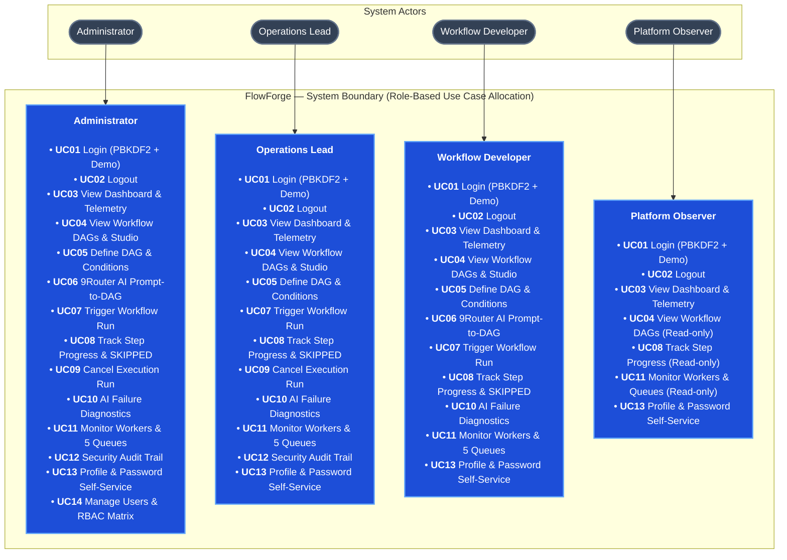

For detailed actors, permissions, and business flows, see [Actors, roles, and use cases](docs/03-use-cases.md).

### 1.4 Roles and permissions

| Capability | Admin | Operations Lead | Developer | Viewer |
|---|---|---|---|---|
| View dashboard & telemetry | Yes | Yes | Yes | Yes |
| View DAGs & Visual Studio | Yes | Yes | Yes | Yes |
| Define & edit DAG workflows | Yes | Yes | Yes | No |
| AI Prompt-to-DAG generator | Yes | No | Yes | No |
| Trigger workflow runs | Yes | Yes | Yes | No |
| Cancel running executions | Yes | Yes | No | No |
| AI failure diagnostics (Self-Healing) | Yes | Yes | Yes | No |
| View worker nodes & 5 queues | Yes | Yes | Yes | Yes |
| Security audit trail (7 actions) | Yes | Yes | No | No |
| User directory & RBAC assignment | Yes | No | No | No |
| Personal profile & password reset | Yes | Yes | Yes | Yes |

The backend enforces RBAC on every API endpoint; hiding frontend controls serves UI/UX only.

---

## 2. Information Architecture, Screen Hierarchy, and UI/UX

The information architecture organizes the authenticated workspace by orchestration capability. Screen permissions and navigation follow the role matrix, while loading, empty, validation, error, saving, and success states are defined consistently.

### 2.1 Information architecture

#### Relume Sitemap


```text
Public Layer
└── /login (Xác thực tài khoản & 4 tài khoản Demo một chạm)

Authenticated Workspace (Shell Layout: Sidebar cố định 260px + Header sticky 68px)
├── [ORCHESTRATION ENGINE]
│   ├── /dashboard          - Giám sát Telemetry, cụm chỉ số KPI & Kích hoạt nhanh
│   ├── /workflows          - Danh mục DAG, Visual Mini-Pipeline & AI Prompt-to-DAG Copilot
│   │   └── /workflows/studio - Visual DAG Builder Studio (Drag-and-Drop Canvas)
│   ├── /executions         - Quản trị lượt chạy, Timeline từng bước, Trạng thái SKIPPED & AI Self-Healing
│   └── /workers            - Cụm Worker Nodes, Concurrency Slots & 5 Hàng đợi Phân tán
│
├── [GOVERNANCE & ADMIN]
│   ├── /audit              - Nhật ký kiểm toán bảo mật bất biến (Security Audit Trail)
│   ├── /users              - Danh bạ tài khoản & Ma trận phân quyền 4 vai trò RBAC
│   └── /profile            - Hồ sơ kỹ sư, Đổi mật khẩu & Thanh tra quyền hạn
│
└── [SYSTEM EXCEPTION]
    └── /403                - Màn hình từ chối truy cập (Access Denied / Forbidden)
```

### 2.2 Screen hierarchy

Login leads to the authenticated shell. The shell owns navigation to feature pages; workflow definition, execution triggering, and AI generation interactions use feature-owned modals. Unauthorized navigation resolves to the Forbidden screen.

Detailed screen IDs, user flows, screen states, accessibility rules, and API mappings are maintained in [Information Architecture](docs/04-information-architecture.md).

### 2.3 Current UI prototype

#### 1. Platform Dashboard & Telemetry


#### 2. Workflows & DAG Definitions


#### 3. Executions & Step Lifecycle


#### 4. Worker Nodes & Task Queues


---

## 3. C4 Architecture

FlowForge follows the **C4 Model** for software architecture to communicate structural design across multiple levels of abstraction.

### C1 — System Context

The System Context diagram illustrates how FlowForge fits into the enterprise ecosystem, the human actors that operate it, and external services it integrates with.

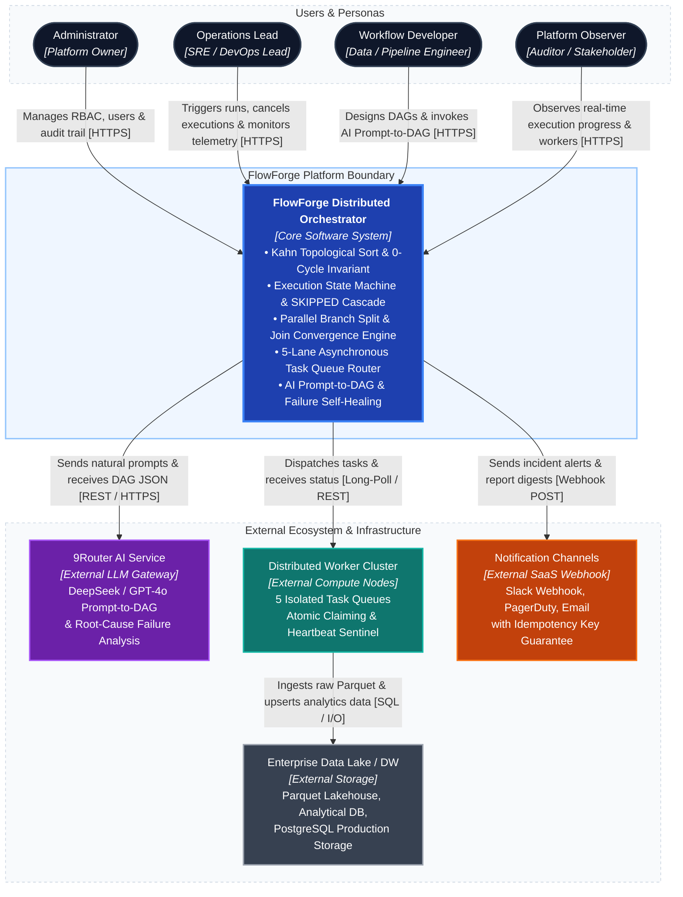

---

### C2 — Container

The Container diagram zooms into the FlowForge platform, illustrating high-level runtime and storage containers, protocols, and data flow.

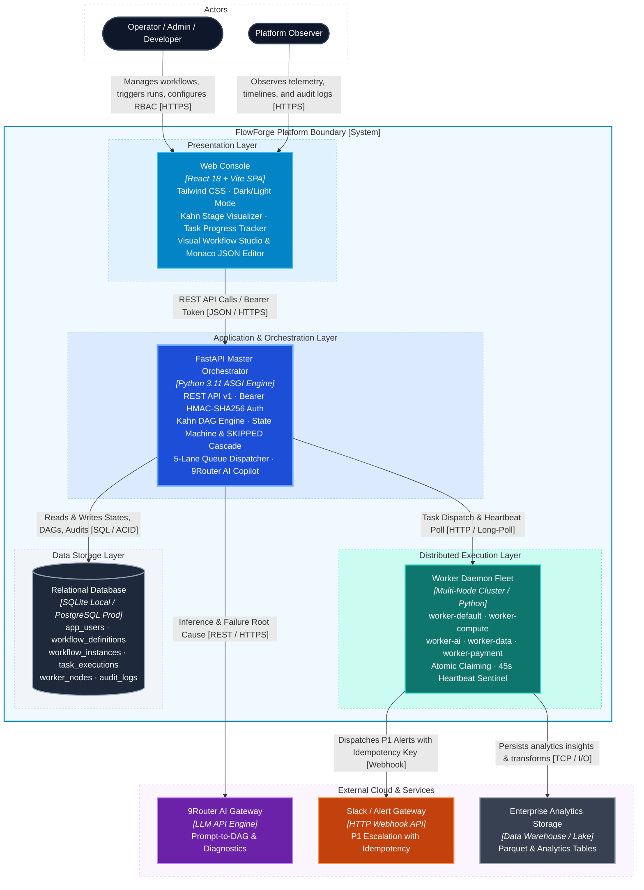

---

### C3 — Component

The Component diagram zooms into the **FastAPI Master Orchestrator Container**, displaying internal architectural tiers, services, and communication flows.

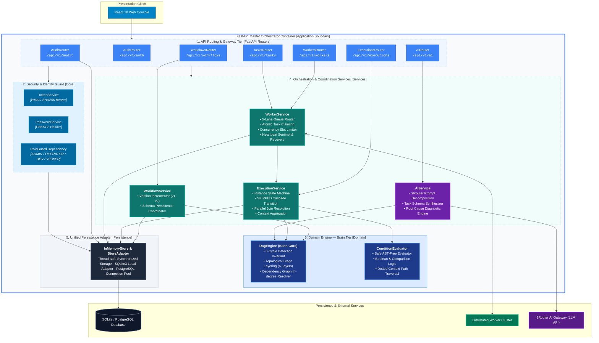

Complete architectural documentation: [C4 Architecture Handbook](docs/architecture/c4/README.md) and [arc42 Engineering Handbook](docs/architecture/arc42/README.md).

---

## 4. Database Diagrams and OpenAPI 3.1 Contract

FlowForge standardizes persistence schemas and the HTTP API contract to guarantee complete cross-system traceability.

### 4.1 Database diagrams

The database model keeps users, workflow definitions, execution instances, task steps, distributed workers, and audit events normalized and relational.

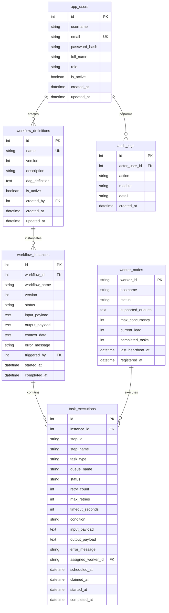

See the [detailed database diagram](docs/DATABASE.md), [data model](docs/05-data-model.md), and [schema DDL](src/database/workflow_orchestrator.sql).

### 4.2 OpenAPI 3.1 API documentation

The HTTP contract is defined in OpenAPI 3.1 and organized into Authentication, Workflows, Executions, Tasks, Workers, AI Engine, and Audit.

```text
16 paths
24 operations
Bearer HMAC-SHA256 token security
Role metadata (ADMIN, OPERATOR, DEVELOPER, VIEWER)
Pydantic Request and Response schemas
RFC 7807-compatible application/problem+json error responses
Swagger UI interactive documentation at /docs
```

Every operation has a stable route, documented parameters, Pydantic request/response models, success/error status codes, and RBAC authorization rules.

- [API documentation and sample calls](docs/api/README.md)
- Interactive Swagger UI: `http://127.0.0.1:8000/docs`

---

## 5. Frontend and Backend Folder Structures

### 5.1 Current repository layout

```text
FlowForge/
├── src/
│   ├── frontend/                     # React 18 + Vite SPA Console
│   │   ├── src/
│   │   │   ├── components/           # Shell, Topbar, BrandLogo
│   │   │   ├── features/             # Feature-driven modules (auth, dashboard, workflows, executions, workers, audit, users, profile)
│   │   │   ├── lib/                  # API client, store, auth, format, icons, theme
│   │   │   ├── App.jsx               # Routes and navigation guards
│   │   │   └── index.css             # High-tech design system (Dark & Light theme)
│   │   ├── public/                   # Static assets
│   │   └── package.json              # Frontend dependencies and 27 Vitest tests
│   ├── backend/                      # Python FastAPI Async Backend
│   │   ├── app/
│   │   │   ├── api/routes/           # Endpoints: auth, workflows, executions, tasks, workers, ai, audit, users
│   │   │   ├── core/                 # Dependencies, exceptions, security, token service
│   │   │   ├── domain/               # Kahn's DAG engine, models, condition evaluator
│   │   │   ├── persistence/          # Store adapter, SQLite / PostgreSQL connection
│   │   │   ├── services/             # Workflow, execution, worker, and AI services
│   │   │   └── worker_agent.py       # Distributed Multi-Worker Cluster Daemon
│   │   ├── tests/                    # 31 Pytest automated test cases (100% Passed)
│   │   ├── pyproject.toml            # Pytest configuration
│   │   └── requirements.txt          # Python dependencies
│   └── database/
│       ├── workflow_orchestrator.db  # SQLite local database
│       ├── workflow_orchestrator.sql # PostgreSQL target schema
│       └── init_db.py                # Schema initialization script
├── docs/                             # Architectural and engineering specifications
│   ├── api/                          # OpenAPI 3.1 contract and usage guide
│   ├── architecture/                 # C4, arc42, class diagrams, sequence diagrams
│   ├── requirements/                 # Business rules and non-functional requirements
│   ├── traceability/                 # Cross-step master traceability matrix
│   ├── images/                       # UI screenshots and visual references
│   └── 01-scope.md … 09-step-7-readiness.md
├── run.sh                            # Unified CLI launcher (backend, frontend, test, worker, db)
├── .env                              # Active local environment variables
├── .env.example                      # Documented environment template
└── README.md
```

### 5.2 Target React feature structure

```text
src/frontend/src/
├── components/          # Shared layout, BrandLogo, Topbar, Shell
├── features/
│   ├── auth/            # hooks/useAuth.js, pages/Login.jsx, services/authService.js
│   ├── dashboard/       # hooks/useDashboard.js, pages/Dashboard.jsx, services/dashboardService.js
│   ├── workflows/       # hooks/useWorkflows.js, pages/WorkflowDefinitionsPage.jsx, components/WorkflowStudio.jsx
│   ├── executions/      # hooks/useExecutions.js, pages/ExecutionsPage.jsx, services/executionService.js
│   ├── workers/         # hooks/useWorkers.js, pages/WorkersPage.jsx, services/workerService.js
│   ├── audit/           # hooks/useAuditLogs.js, pages/AuditPage.jsx, services/auditService.js
│   ├── users/           # hooks/useUsers.js, pages/UsersPage.jsx, services/userService.js
│   └── profile/         # pages/ProfilePage.jsx (Self-service profile and RBAC matrix)
├── services/            # Base apiClient and HTTP utilities
├── lib/                 # Store, auth context, date/number formatting, icons, theme
└── test/                # Setup and Vitest unit/integration tests (27 tests pass)
```

Target dependency flow:
```text
Page/Component → Feature Hook → Feature Service → apiClient → FastAPI REST API
```

### 5.3 Target FastAPI backend structure

```text
src/backend/app/
├── api/
│   ├── router.py                     # Aggregated API router (/api/v1)
│   └── routes/                       # Modular endpoints (auth, workflows, executions, tasks, workers, ai, audit, users)
├── core/
│   ├── dependencies.py               # RBAC role guards and Bearer token extraction
│   ├── exceptions.py                 # RFC 7807 problem details error mapping
│   └── security.py                   # PBKDF2 password hasher & HMAC-SHA256 token service
├── domain/
│   ├── dag_engine.py                 # Kahn's algorithm, cycle validation, step readiness, condition evaluation
│   └── models.py                     # Pydantic domain models & request/response contracts
├── persistence/
│   ├── database.py                   # Database engine, connection pooling
│   └── store.py                      # Thread-safe in-memory & relational store adapter
├── services/
│   ├── ai_service.py                 # Prompt-to-DAG & failure diagnostics (Self-Healing)
│   ├── execution_service.py          # State machine, step advancement, conditional cascade, cancel
│   ├── worker_service.py             # Heartbeat monitor, queue polling, atomic task claimer
│   └── workflow_service.py           # DAG CRUD & persistence
└── worker_agent.py                   # Multi-worker daemon cluster (5 queue pools)
```

---

## 6. Detailed Class and Sequence Design

Detailed design derives from the C4 components in Step 3, the database and OpenAPI contracts in Step 4, and the folder ownership in Step 5.

### 6.1 C4 Level 4 — Code collaboration

#### L4.1 Workflow Execution & Task Lifecycle Management

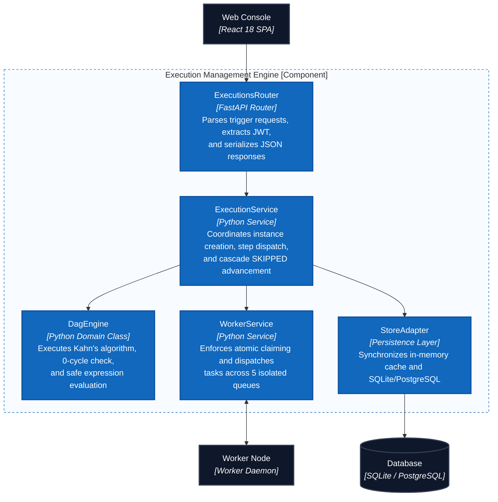

#### L4.2 AI Failure Diagnostics & Self-Healing

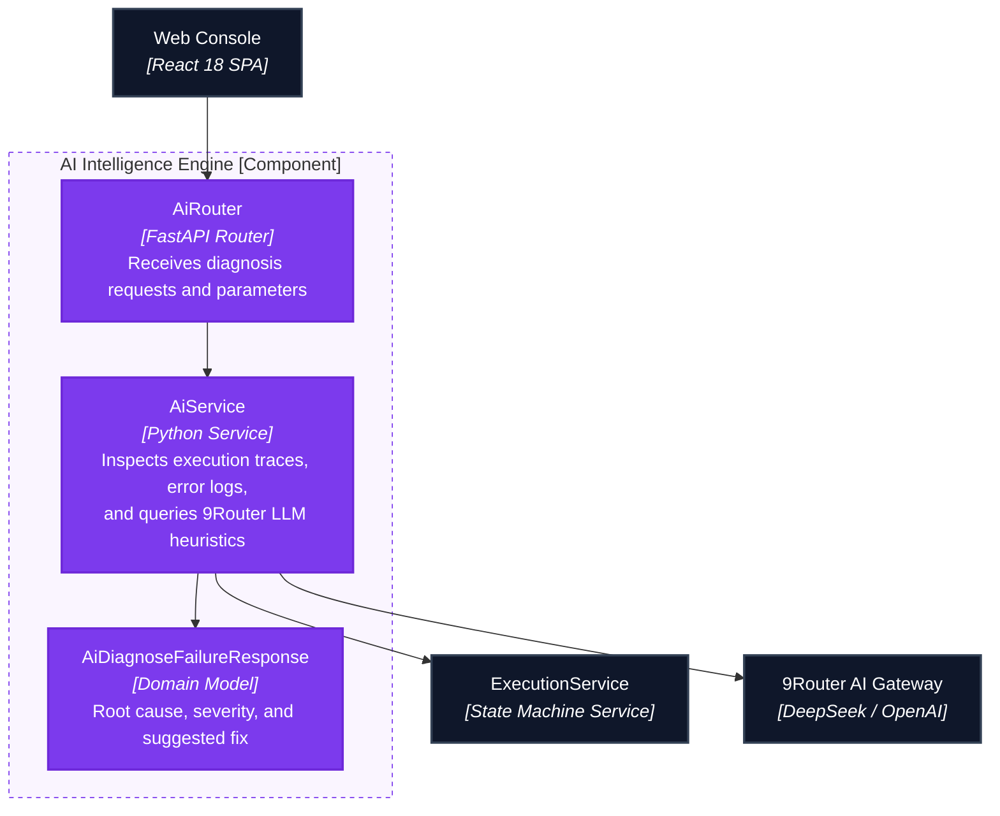

---

### 6.2 Core class diagrams

#### 1. Authentication & Identity

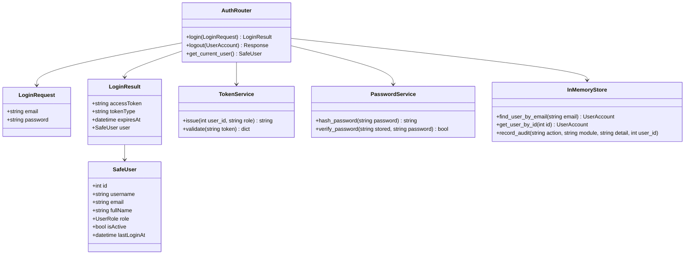

#### 2. Workflow & DAG Engine

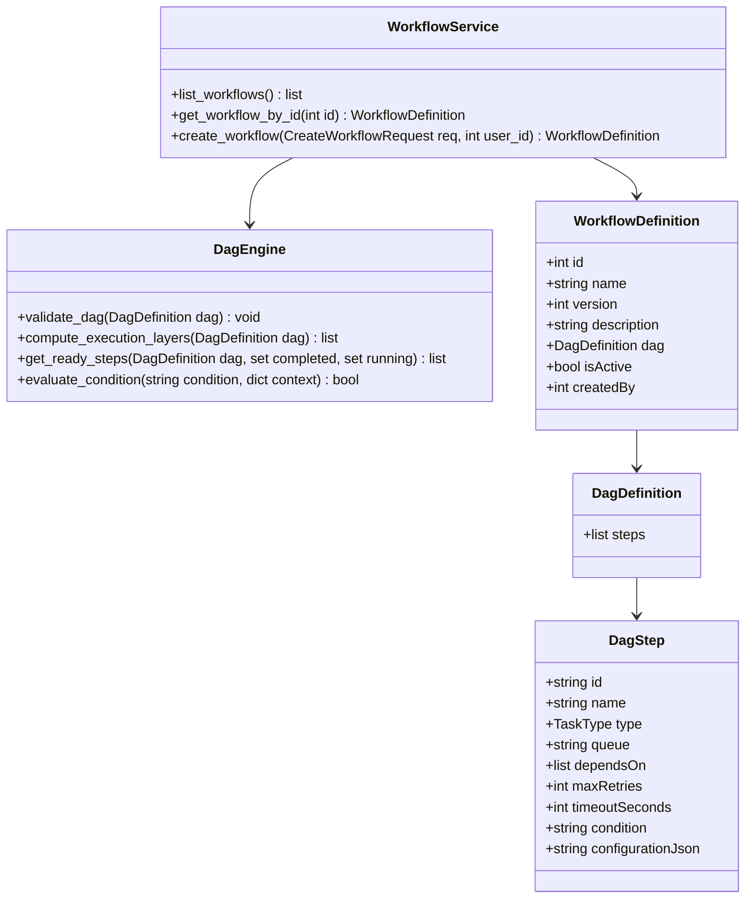

#### 3. Execution Lifecycle & Worker Dispatch

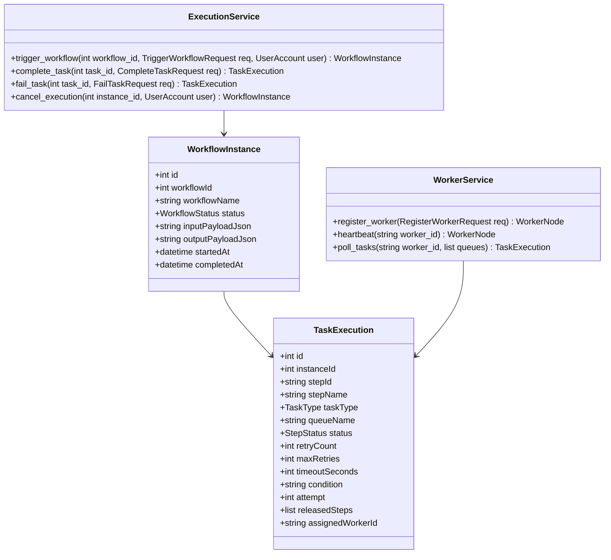

Source: [Core Class Diagrams](docs/architecture/uml/01-class-diagrams.md)

---

### 6.3 Sequence diagrams

The runtime sequence illustrates parallel branch execution, conditional step evaluation, atomic claiming, and join resolution:

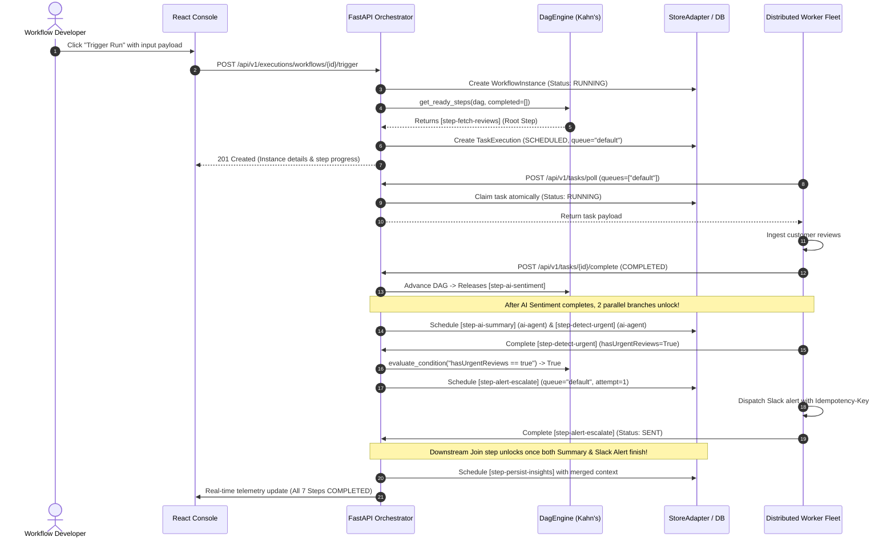

- [Core sequence diagrams](docs/architecture/uml/02-sequence-diagrams.md)
- [API runtime sequences and operation traceability](docs/architecture/uml/03-api-traceability.md)

---

## Quick Start & Runbook

FlowForge provides a unified CLI runner script `./run.sh` to manage the backend orchestrator, frontend developer console, distributed worker agent, automated test suites, and database seeding.

### 1. Launch FastAPI Backend (Terminal 1)
```bash
./run.sh backend
# Orchestrator API listening at http://127.0.0.1:8000
# Interactive OpenAPI Swagger UI at http://127.0.0.1:8000/docs
```

### 2. Launch React Developer Console (Terminal 2)
```bash
./run.sh frontend
# Vite Dev Server listening at http://localhost:5173
```

### 3. Launch Distributed Worker Daemon (Terminal 3)
```bash
./run.sh worker
# Connects to Orchestrator and continuously claims tasks across 5 isolated queues:
# [default, compute, data-io, payment, ai-agent]
```

### 4. Run Automated Test Suites
```bash
# Run 31 Backend Pytest suites (Kahn DAG engine, state machine, worker queues, AI service, branching)
./run.sh test

# Run 27 Frontend Vitest suites (React UI, API client, custom hooks, Visual Studio)
cd src/frontend && npm test
```

### 5. Pre-configured Demo Accounts
| Role | Email | Password | Capabilities |
|---|---|---|---|
| **Administrator** | `admin@orchestrator.local` | `ChangeMe123!` | Full cluster governance, user directory, immutable security audit trail |
| **Operations Lead** | `operator@orchestrator.local` | `ChangeMe123!` | Trigger workflows, cancel executions, manage worker nodes, inspect telemetry |
| **Workflow Developer** | `dev@orchestrator.local` | `ChangeMe123!` | Design DAG definitions, Visual Studio drag-and-drop, AI Prompt-to-DAG Copilot |
| **Platform Observer** | `viewer@orchestrator.local` | `ChangeMe123!` | Read-only dashboard, executions monitoring, worker queue metrics |

---

## Documentation

- Requirements: [Scope](docs/01-scope.md), [Features](docs/02-features.md), [INVEST backlog](docs/08-invest-requirements.md), [Acceptance criteria](docs/06-acceptance-criteria.md).
- Requirements catalogs: [Business rules](docs/requirements/business-rules.md) and [Non-functional requirements](docs/requirements/non-functional-requirements.md).
- UI/UX: [Information architecture & Relume Sitemap](docs/04-information-architecture.md).
- Database: [Data model](docs/05-data-model.md), [ER diagram](docs/DATABASE.md), [PostgreSQL schema](src/database/workflow_orchestrator.sql).
- Folder structure: [React and FastAPI backend](docs/07-folder-structure.md).
- Code-level design: [Core class diagrams](docs/architecture/uml/01-class-diagrams.md), [core sequences](docs/architecture/uml/02-sequence-diagrams.md), and [API traceability/sequences](docs/architecture/uml/03-api-traceability.md).
- API contract: [API documentation](docs/api/README.md) and Swagger UI at `http://127.0.0.1:8000/docs`.

---

## Project Progress

- [x] Define scope, goals, and user roles
- [x] Write the feature list and use cases
- [x] Write user stories following INVEST
- [x] Write acceptance criteria and business rules
- [x] Write non-functional requirements
- [x] Design the information architecture and screen permissions
- [x] Design the screen hierarchy, task flows, and UI states
- [x] Build the React UI prototype for each role
- [x] Design the C4 System Context (C1)
- [x] Design the C4 Container (C2)
- [x] Design the C4 Component (C3) and arc42 documentation
- [x] Design the SQLite / PostgreSQL schema, DBML, and data relationships
- [x] Write the API documentation in OpenAPI 3.1
- [x] Design the React frontend folder structure
- [x] Design the FastAPI backend folder structure
- [x] Design class diagrams and sequence diagrams
- [x] Create traceability between requirements, screens, API, and database
- [x] Build the FastAPI async backend engine
- [x] Build the authentication, user management, and personal profile API
- [x] Implement the Kahn algorithm DAG cycle detection, validation, and stage partitioning
- [x] Implement the workflow execution state machine and step advancement
- [x] Implement conditional branching (`condition`) and automatic `SKIPPED` cascade resolution
- [x] Implement parallel branch fork & join convergence with context aggregation
- [x] Implement distributed worker queue dispatching across 5 isolated queues
- [x] Implement atomic task claiming, concurrency slots, and stale worker recovery
- [x] Implement the 9Router AI Prompt-to-DAG generator and failure self-healing diagnostics
- [x] Write unit tests and API integration tests (**31/31 Pytest tests passed**)
- [x] Connect the React frontend to the API (login, workflows, studio, executions, workers, users, profile, audit)
- [x] Add high-tech developer console design system with Dark / Light theme toggle
- [x] Record immutable audit events across 7 operational actions (LOGIN, CREATE, TRIGGER, CANCEL, SKIP, RETRY, FAIL)
- [x] Add frontend tests with Vitest (**27/27 tests passed**)
- [ ] Connect production-grade Kafka / RabbitMQ broker adapter for ultra-high throughput worker clusters
- [ ] Deploy multi-region Kubernetes cluster with Horizontal Pod Autoscaler (HPA) for compute workers
