# Distributed Workflow Orchestration Platform (DWOP)

Distributed Workflow Orchestration Platform (DWOP) helps engineering and operations teams orchestrate complex, multi-step distributed workflows as Directed Acyclic Graphs (DAG), manage asynchronous task dispatch across isolated worker queues, automate failure self-healing with AI, and track end-to-end execution lifecycle and audit logs in one unified console.

## 1. Requirements — INVEST, Use Cases, and Acceptance Criteria

Requirements define what Distributed Workflow Orchestration Platform must do, who uses it, the value delivered, and the observable conditions of success. User stories are reviewed with INVEST and mapped to use cases and acceptance criteria.

### 1.1 Product mind map

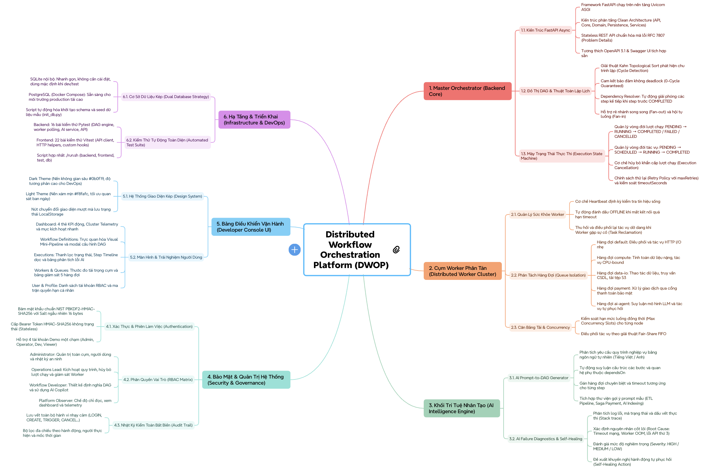

### 1.2 INVEST requirements

The V1 backlog includes 13 user stories. These stories cover authentication, cluster dashboard, workflow DAG definition, AI prompt-to-DAG generation, execution triggering, real-time step progress tracking, execution cancellation, AI failure diagnosis and self-healing, worker queue monitoring, audit logs, user RBAC, and personal profile management.
Before a user story is ready for development, it is checked using the INVEST criteria.

| Criterion | Meaning in Distributed Workflow Orchestration Platform |
|---|---|
| **Independent** | Each story should provide a clear feature and depend on other stories only when necessary (e.g. DAG cycle validation is independent of worker polling). |
| **Negotiable** | The UI layout and implementation details can change as long as the core orchestration guarantees and permission rules stay the same. |
| **Valuable** | Each story should provide value to the operator, developer, or platform reliability. |
| **Estimable** | Roles, inputs, outputs, queue routing, retry policies, and failure outcomes are documented. |
| **Small** | Each story covers one primary capability and can be divided into API, domain engine, worker dispatcher, UI, and test tasks. |
| **Testable** | Every story maps to observable acceptance criteria and expected authorization, cycle validation, state machine transition, and error behavior. |

```text
US01–US02   Authentication and session
US03        Cluster telemetry and dashboard
US04–US05   Workflow DAG definitions and AI Prompt-to-DAG
US06–US08   Execution triggering, step progress, and cancellation
US09        AI failure diagnostics and self-healing recommendations
US10        Distributed worker cluster and queue monitoring
US11        Audit trail and compliance logging
US12        User management and RBAC policy
US13        Personal profile and credentials
```

All V1 stories have estimable target behavior. DAG cycle validation is deterministic via Kahn's algorithm, task dispatching is isolated across 5 queues, and execution state machine transitions are atomic. The complete story-level review is maintained in [INVEST Requirements](docs/08-invest-requirements.md).

### 1.3 Use cases

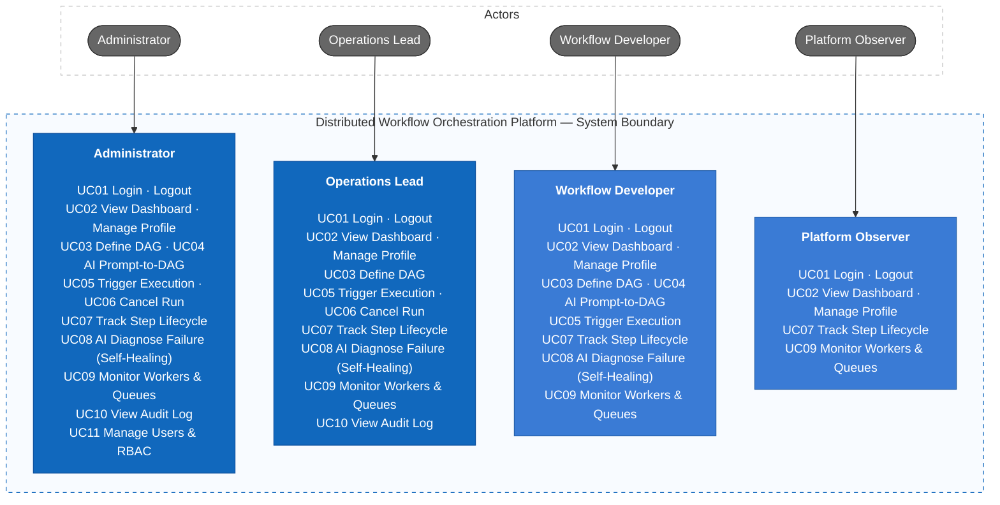

For detailed actors, permissions, and business flows, see [Actors, roles, and use cases](docs/03-use-cases.md).

### 1.4 Roles and permissions

| Capability | Admin | Operations Lead | Developer | Viewer |
|---|---|---|---|---|
| View dashboard & telemetry | Yes | Yes | Yes | Yes |
| Define & edit DAG workflows | Yes | Yes | Yes | No |
| AI Prompt-to-DAG generator | Yes | No | Yes | No |
| Trigger workflow runs | Yes | Yes | Yes | No |
| Cancel executions | Yes | Yes | No | No |
| AI failure diagnostics | Yes | Yes | Yes | No |
| View worker nodes & queues | Yes | Yes | Yes | Yes |
| Activity audit trail | Yes | Yes | No | No |
| User management & RBAC | Yes | No | No | No |

The backend enforces RBAC on every API endpoint; hiding frontend controls serves UI/UX only.

---

## 2. Information Architecture, Screen Hierarchy, and UI/UX

The information architecture organizes the authenticated workspace by orchestration capability. Screen permissions and navigation follow the role matrix, while loading, empty, validation, error, saving, and success states are defined consistently.

### 2.1 Information architecture

#### Relume Sitemap
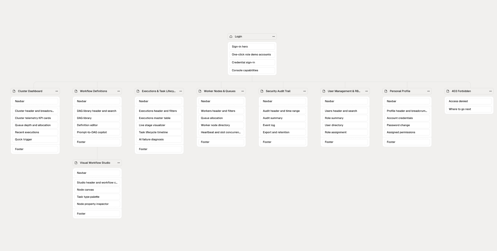

```text
Public
└── Login

Authenticated (Shell Layout)
├── Dashboard (Telemetry, KPIs, Quick Trigger)
├── Workflows (DAG Definitions, Visual Mini-Pipeline, AI Prompt-to-DAG)
├── Executions (Runs Timeline, Step Progress, AI Self-Healing)
├── Workers (Worker Nodes, Concurrency Slots, 5 Task Queues)
├── Audit (Immutable Security Audit Trail)
├── Users (RBAC Matrix, Account Directory)
├── Profile (Credentials, Permissions Matrix)
└── Forbidden (403 Access Denied)
```

### 2.2 Screen hierarchy

Login leads to the authenticated shell. The shell owns navigation to feature pages; workflow definition, execution triggering, and AI generation interactions use feature-owned modals. Unauthorized navigation resolves to the Forbidden screen.

Detailed screen IDs, user flows, screen states, accessibility rules, and API mappings are maintained in [Information Architecture](docs/04-information-architecture.md).

### 2.3 Current UI prototype

#### 1. Platform Dashboard & Telemetry
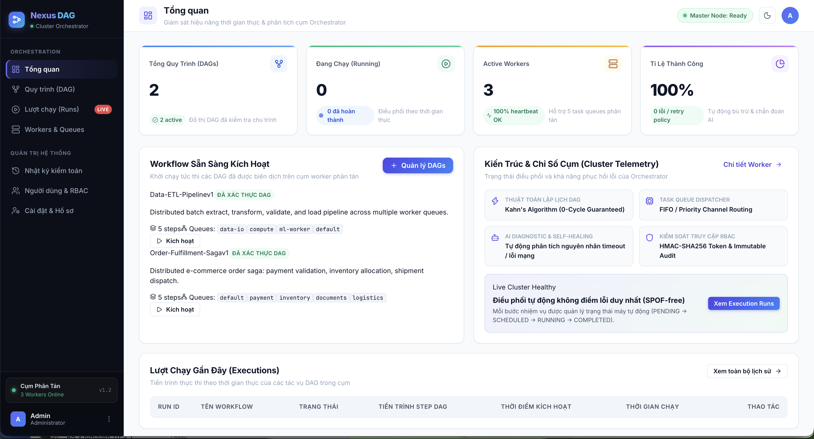

#### 2. Workflows & DAG Definitions
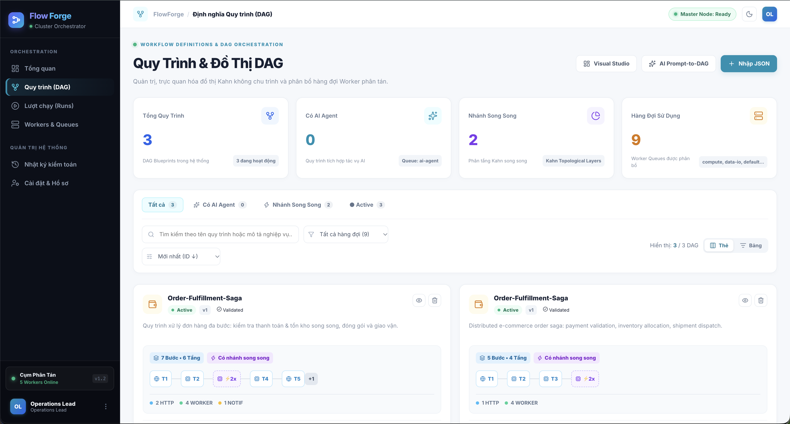

#### 3. Executions & Step Lifecycle
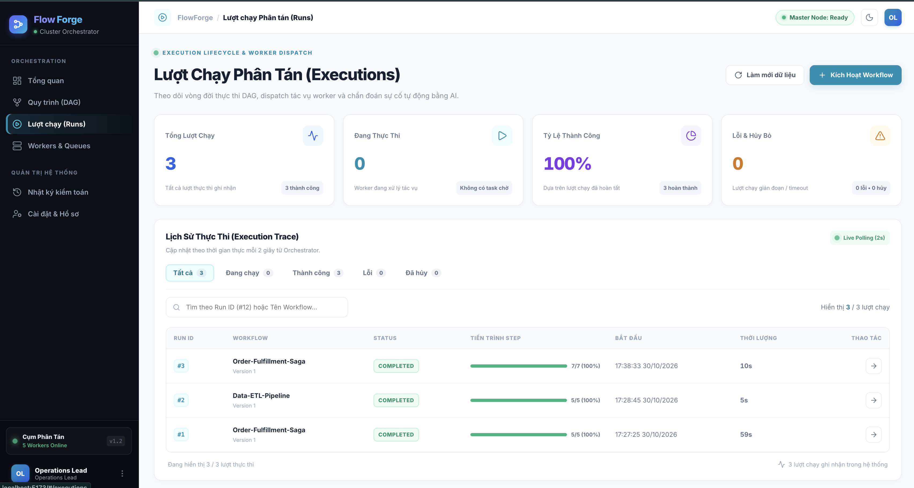

#### 4. Worker Nodes & Task Queues
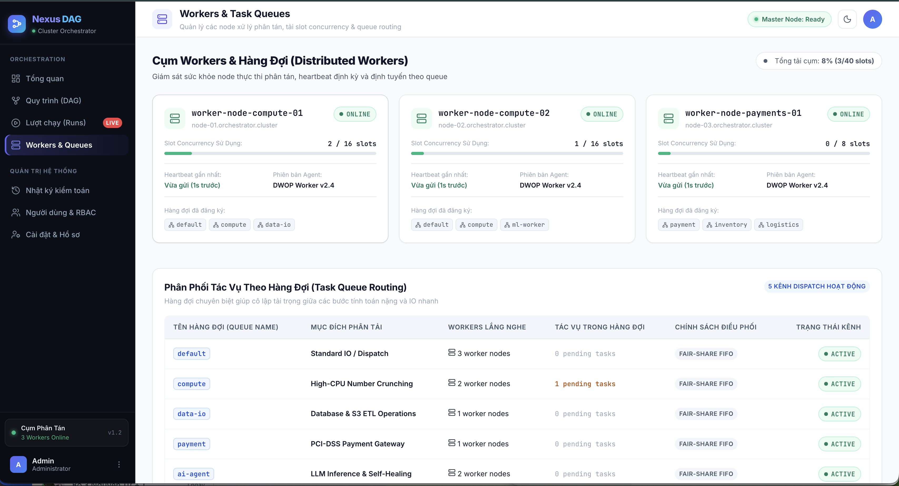

---

## 3. C4 Architecture

This README presents only C1–C3. C4 Level 4 and detailed UML are maintained in the architecture documentation directory.

### C1 — System Context

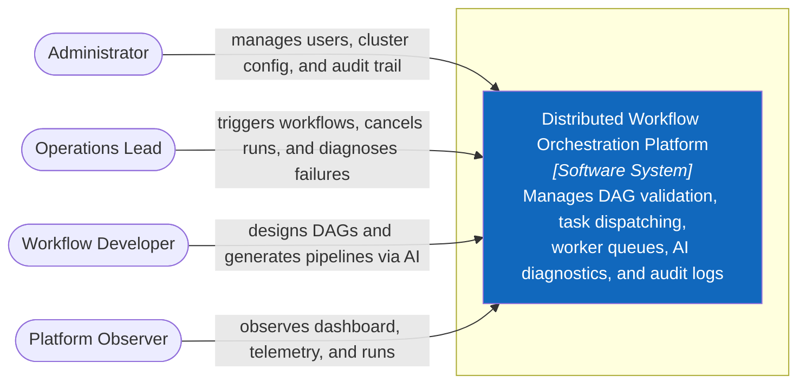

### C2 — Container

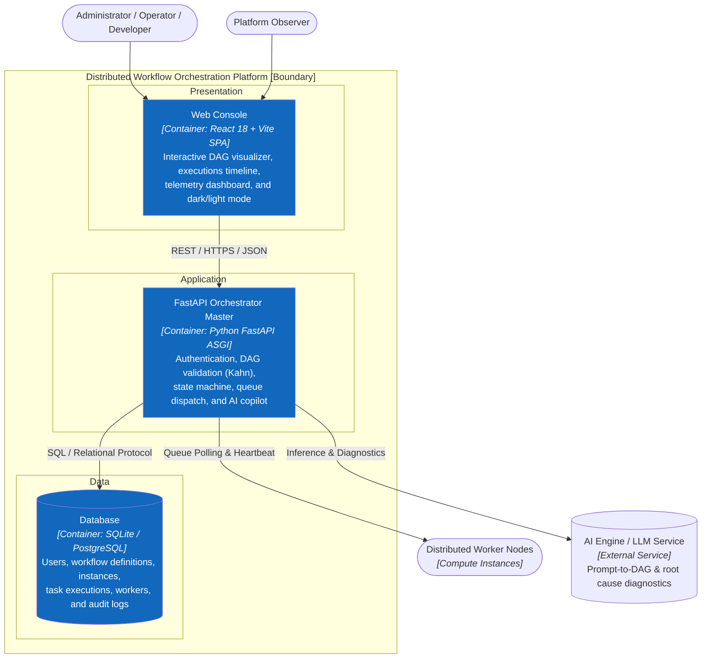

### C3 — Component

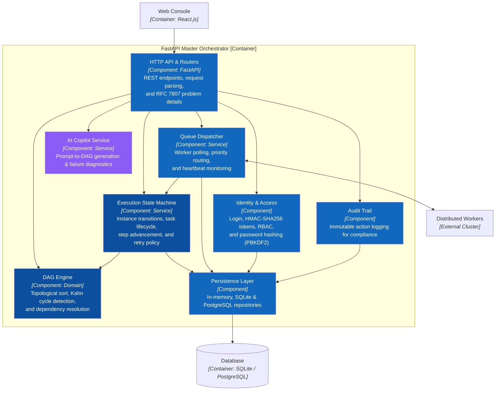

Complete documentation: [C4 Architecture](docs/architecture/c4/README.md) and [arc42 Architecture Handbook](docs/architecture/arc42/README.md).

---

## 4. Database Diagrams and OpenAPI 3.0 Contract

Step 4 defines the persistence contract and the HTTP contract connecting the React console to the backend.

### 4.1 Database diagrams

The database model keeps users, workflow definitions, execution instances, task steps, distributed workers, and audit events normalized and relational.

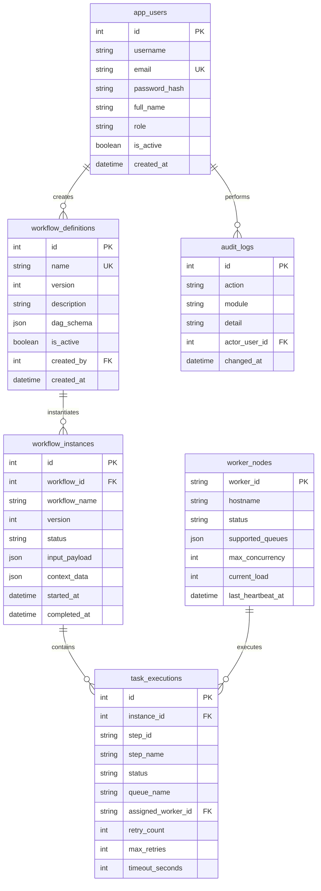

See the [detailed database diagram](docs/DATABASE.md), [data model](docs/05-data-model.md), and [schema DDL](src/database/workflow_orchestrator.sql).

### 4.2 OpenAPI 3.0 API documentation

The HTTP contract is defined in OpenAPI 3.0 and organized into Authentication, Workflows, Executions, Workers, AI Engine, Audit, and Users.

```text
16 paths
24 operations
Bearer HMAC-SHA256 token security
Role metadata (ADMIN, OPERATOR, DEVELOPER, VIEWER)
JSON request and response schemas
RFC 7807-compatible application/problem+json error responses
Swagger UI interactive documentation at /docs
```

Every operation has a stable route, documented parameters, Pydantic request/response models, success/error status codes, and RBAC authorization rules.

- [API documentation and sample calls](docs/api/README.md)
- Interactive Swagger UI: `http://127.0.0.1:8000/docs`

---

## 5. Frontend and Backend Folder Structures

### 5.1 Current repository layout

```text
finance-manager/
├── src/
│   ├── frontend/                     # React 18 + Vite SPA Console
│   │   ├── src/
│   │   │   ├── components/           # Shell, Topbar, BrandLogo
│   │   │   ├── features/             # Feature-driven modules (pages, hooks, services)
│   │   │   ├── lib/                  # API client, store, auth, format, icons
│   │   │   ├── App.jsx               # Routes and navigation guards
│   │   │   └── index.css             # High-tech design system (Dark & Light theme)
│   │   ├── public/                   # Static assets
│   │   └── package.json              # Frontend dependencies and test scripts
│   ├── backend/                      # Python FastAPI Async Backend
│   │   ├── app/
│   │   │   ├── api/routes/           # Endpoints: auth, workflows, executions, workers, ai, audit
│   │   │   ├── core/                 # Dependencies, exceptions, security, token service
│   │   │   ├── domain/               # Kahn's DAG engine, Pydantic models
│   │   │   ├── persistence/          # Store adapter, SQLite / PostgreSQL connection
│   │   │   └── services/             # Workflow, execution, worker, and AI services
│   │   ├── tests/                    # 16 Pytest automated test cases
│   │   ├── pyproject.toml            # Pytest configuration
│   │   └── requirements.txt          # Python dependencies
│   └── database/
│       ├── workflow_orchestrator.db  # SQLite local database
│       ├── workflow_orchestrator.sql # PostgreSQL target schema
│       └── init_db.py                # Schema initialization script
├── docs/                             # Architectural and engineering specifications
│   ├── api/                          # OpenAPI contract and usage guide
│   ├── architecture/                 # C4, arc42, class diagrams, sequence diagrams
│   ├── requirements/                 # Business rules and non-functional requirements
│   ├── traceability/                 # Cross-step master traceability matrix
│   ├── images/                       # UI screenshots and visual references
│   └── 01-scope.md … 09-step-7-readiness.md
├── run.sh                            # Unified CLI launcher (backend, frontend, test, db)
├── .env                              # Active local environment variables
├── .env.example                      # Documented environment template
└── README.md
```

### 5.2 Target React feature structure

```text
src/frontend/src/
├── components/          # Shared layout, BrandLogo, Topbar, Shell
├── features/
│   ├── auth/            # hooks/useAuth.js, pages/Login.jsx, services/authService.js
│   ├── dashboard/       # hooks/useDashboard.js, pages/Dashboard.jsx, services/dashboardService.js
│   ├── workflows/       # hooks/useWorkflows.js, pages/WorkflowDefinitionsPage.jsx, services/workflowService.js
│   ├── executions/      # hooks/useExecutions.js, pages/ExecutionsPage.jsx, services/executionService.js
│   ├── workers/         # hooks/useWorkers.js, pages/WorkersPage.jsx, services/workerService.js
│   ├── audit/           # hooks/useAuditLogs.js, pages/AuditPage.jsx, services/auditService.js
│   ├── users/           # hooks/useUsers.js, pages/UsersPage.jsx, services/userService.js
│   └── profile/         # pages/ProfilePage.jsx (Self-service profile and RBAC matrix)
├── services/            # Base apiClient and HTTP utilities
├── lib/                 # Store, auth context, date/number formatting, icons
└── test/                # Setup and Vitest unit/integration tests
```

Target dependency flow:
```text
Page/Component → Feature Hook → Feature Service → apiClient → FastAPI REST API
```

### 5.3 Target FastAPI backend structure

```text
src/backend/app/
├── api/
│   ├── router.py                     # Aggregated API router
│   └── routes/                       # Modular endpoints (auth, workflows, executions, workers, ai, audit)
├── core/
│   ├── dependencies.py               # RBAC role guards and Bearer token extraction
│   ├── exceptions.py                 # RFC 7807 problem details error mapping
│   └── security.py                   # PBKDF2 password hasher & HMAC-SHA256 token service
├── domain/
│   ├── dag_engine.py                 # Kahn's algorithm, cycle validation, step readiness
│   └── models.py                     # Pydantic domain models & request/response contracts
├── persistence/
│   ├── database.py                   # Database engine, connection pooling
│   └── store.py                      # Thread-safe in-memory & relational store adapter
└── services/
    ├── ai_service.py                 # Prompt-to-DAG & failure diagnostics (Self-Healing)
    ├── execution_service.py          # State machine, step advancement, cancel execution
    ├── worker_service.py             # Heartbeat monitor, queue polling, task completion
    └── workflow_service.py           # DAG CRUD & persistence
```

---

## 6. Detailed Class and Sequence Design

Detailed design derives from the C4 components in Step 3, the database and OpenAPI contracts in Step 4, and the folder ownership in Step 5.

### 6.1 C4 Level 4 — Code collaboration

#### L4.1 Workflow Execution Management

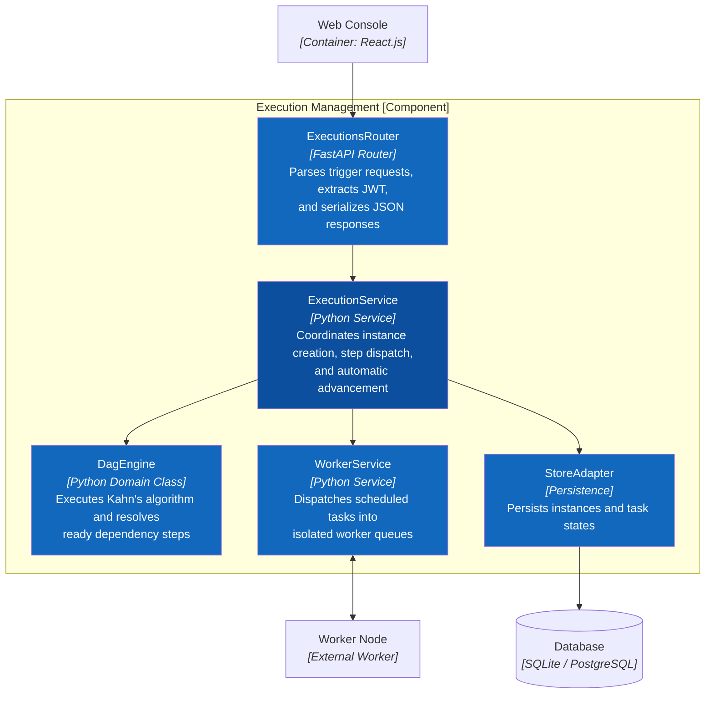

#### L4.2 AI Failure Diagnostics & Self-Healing

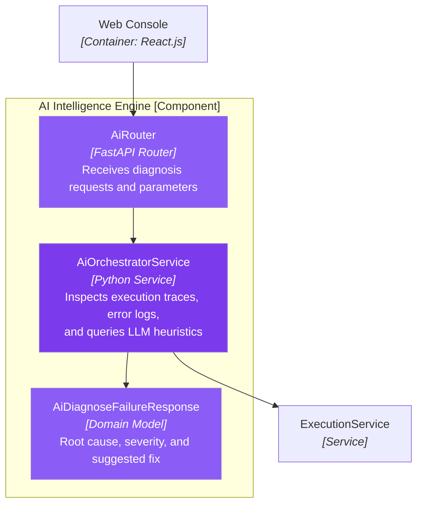

Source: [C4 Level 4 — Code](docs/architecture/c4/04-code.md)

### 6.2 Core class diagrams

#### 1. Authentication & Identity

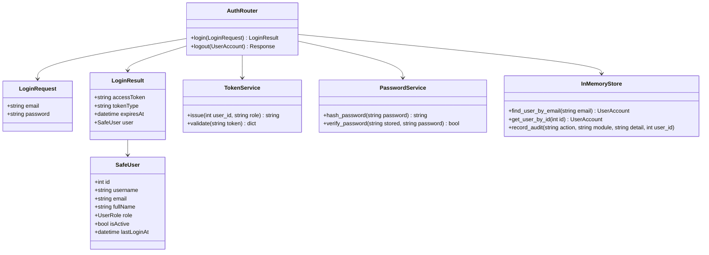

#### 2. Workflow & DAG Engine

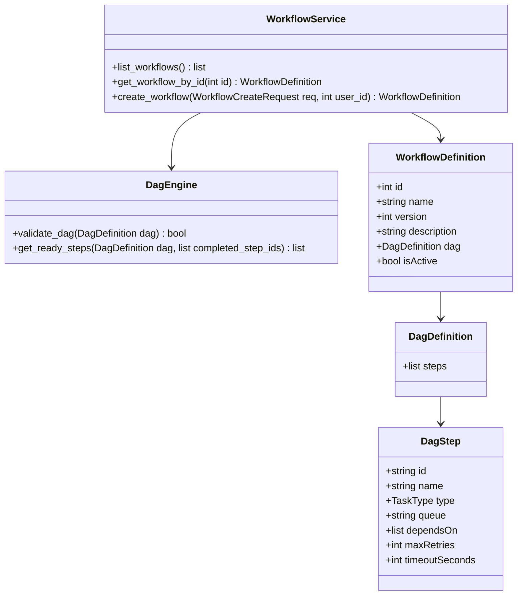

#### 3. Execution Lifecycle & Worker Dispatch

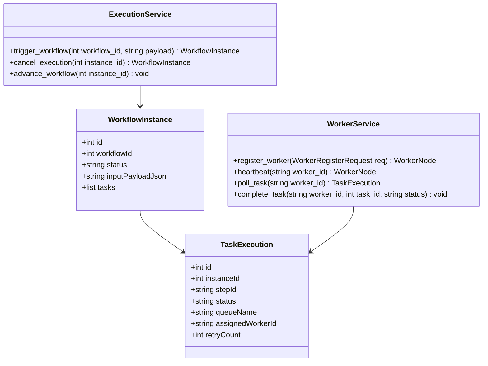

Source: [Core Class Diagrams](docs/architecture/uml/01-class-diagrams.md)

### 6.3 Sequence diagrams

Runtime sequences cover authentication, workflow DAG creation with Kahn cycle validation, execution triggering and step dispatching, worker task polling, heartbeat management, and AI failure diagnostics.

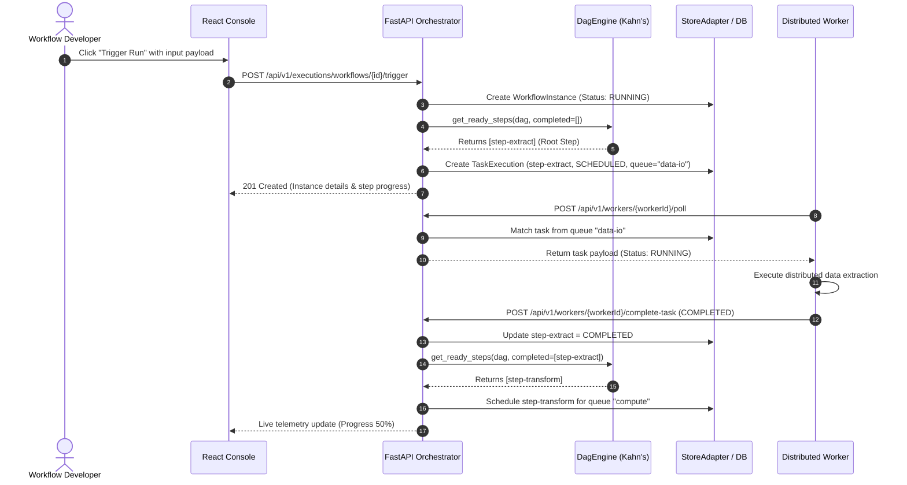

- [Core sequence diagrams](docs/architecture/uml/02-sequence-diagrams.md)
- [API runtime sequences and operation traceability](docs/architecture/uml/03-api-traceability.md)

---

## Documentation

- Requirements: [Scope](docs/01-scope.md), [Features](docs/02-features.md), [INVEST backlog](docs/08-invest-requirements.md), [Acceptance criteria](docs/06-acceptance-criteria.md).
- Requirements catalogs: [Business rules](docs/requirements/business-rules.md) and [Non-functional requirements](docs/requirements/non-functional-requirements.md).
- UI/UX: [Information architecture](docs/04-information-architecture.md).
- Database: [Data model](docs/05-data-model.md), [ER diagram](docs/DATABASE.md), [PostgreSQL schema](src/database/workflow_orchestrator.sql).
- Folder structure: [React and FastAPI backend](docs/07-folder-structure.md).
- Code-level design: [Core class diagrams](docs/architecture/uml/01-class-diagrams.md), [core sequences](docs/architecture/uml/02-sequence-diagrams.md), and [API traceability/sequences](docs/architecture/uml/03-api-traceability.md).
- API contract: [API documentation](docs/api/README.md) and Swagger UI at `http://127.0.0.1:8000/docs`.

---

## Project Progress

- [x] Define scope, goals, and user roles
- [x] Write the feature list and use cases
- [x] Write user stories following INVEST
- [x] Write acceptance criteria and business rules
- [x] Write non-functional requirements
- [x] Design the information architecture and screen permissions
- [x] Design the screen hierarchy, task flows, and UI states
- [x] Build the React UI prototype for each role
- [x] Design the C4 System Context
- [x] Design the C4 Container
- [x] Design the C4 Component and arc42 documentation
- [x] Design the SQLite / PostgreSQL schema, DBML, and data relationships
- [x] Write the API documentation in OpenAPI 3.0
- [x] Design the React frontend folder structure
- [x] Design the FastAPI backend folder structure
- [x] Design class diagrams and sequence diagrams
- [x] Create traceability between requirements, screens, API, and database
- [x] Build the FastAPI async backend engine
- [x] Build the authentication, user management, and personal profile API
- [x] Implement the Kahn algorithm DAG cycle detection and validation
- [x] Implement the workflow execution state machine and step advancement
- [x] Implement the distributed worker queue dispatching (5 isolated queues)
- [x] Implement the AI Prompt-to-DAG generator and failure self-healing diagnostics
- [x] Write unit tests and API integration tests (16/16 Pytest tests pass)
- [x] Connect the React frontend to the API (login, workflows, executions, workers, users, profile, audit)
- [x] Add high-tech developer console design system with Dark / Light theme toggle
- [x] Record audit events for login, logout, workflow creation, trigger, and cancellation
- [x] Add frontend tests with Vitest (22/22 tests pass)
- [ ] Connect production-grade Kafka / RabbitMQ broker adapter for ultra-high throughput worker clusters
- [ ] Deploy multi-region Kubernetes cluster with Horizontal Pod Autoscaler (HPA) for compute workers
