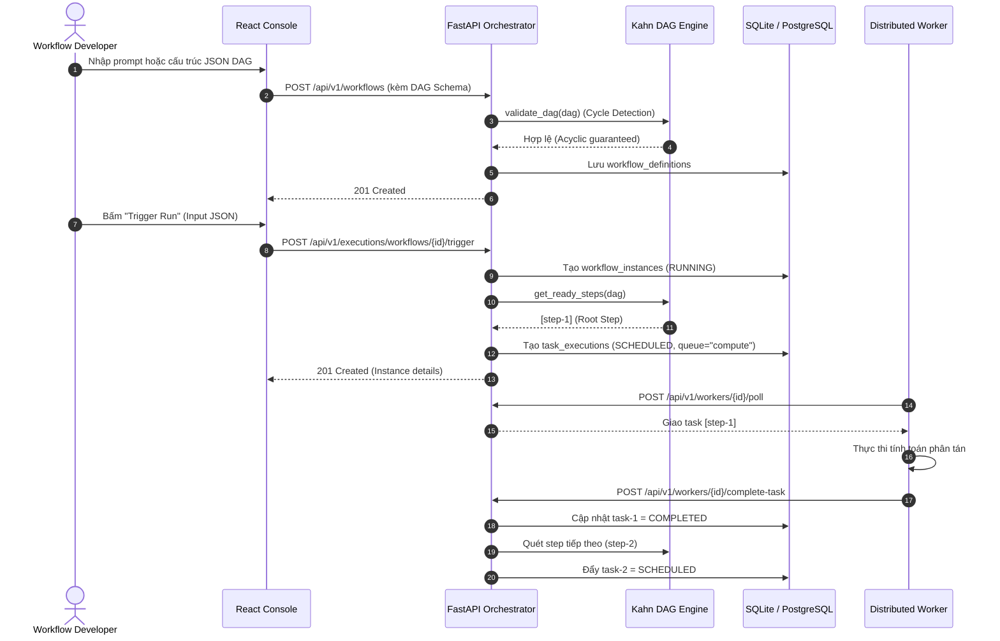

# Features Specification — Distributed Workflow Orchestration Platform

Tài liệu đặc tả chi tiết các tính năng của nền tảng **DWOP (Distributed Workflow Orchestration Platform)**.

---

## 1. Danh Mục Tính Năng (Feature Inventory)

| Mã | Tính Năng | Mô Tả Nghiệp Vụ | Vai Trò Hỗ Trợ |
| :--- | :--- | :--- | :--- |
| **FEAT-01** | **Xác thực & Phiên làm việc** | Đăng nhập bằng Email/Password (PBKDF2), cấp Bearer Token HMAC-SHA256, hỗ trợ 4 tài khoản demo một chạm. | Mọi vai trò |
| **FEAT-02** | **Bảng Điều Khiển (Dashboard)** | Thống kê số lượng DAG, lượt chạy đang chạy, tỷ lệ thành công, tình trạng Worker Nodes và kích hoạt nhanh. | Mọi vai trò |
| **FEAT-03** | **Quản lý Định Nghĩa DAG** | Xem, tạo mới và lưu trữ các quy trình DAG. Kiểm tra tính hợp lệ và loại trừ chu trình lặp (Cycle Detection). | Developer, Admin |
| **FEAT-04** | **AI Prompt-to-DAG** | Trợ lý AI tự động sinh cấu trúc DAG hoàn chỉnh từ câu lệnh tiếng Việt/Anh kèm gợi ý prompt mẫu. | Developer, Admin |
| **FEAT-05** | **Kích hoạt & Điều phối Runs** | Kích hoạt lượt chạy mới với Input Payload (JSON), tự động phân rã thành các task con có phụ thuộc. | Operator, Admin |
| **FEAT-06** | **Theo dõi Tiến trình Step** | Trực quan hóa tiến độ step theo thời gian thực (Progress Bar, Timeline dọc, gán Worker, đếm retry). | Mọi vai trò |
| **FEAT-07** | **AI Chẩn đoán Lỗi (Self-Healing)**| Phân tích nguyên nhân gốc khi lượt chạy bị FAILED và đưa ra khuyến nghị tự khắc phục. | Operator, Dev, Admin |
| **FEAT-08** | **Quản lý Cụm Workers** | Giám sát trạng thái Online/Offline, tín hiệu Heartbeat và mức chiếm dụng slot concurrency của từng node. | Mọi vai trò |
| **FEAT-09** | **Điều phối Hàng Đợi (Queues)** | Phân phối tác vụ theo 5 queue độc lập (`default`, `compute`, `data-io`, `payment`, `ai-agent`). | Operator, Admin |
| **FEAT-10** | **Nhật ký Kiểm toán (Audit)** | Lưu vết bất biến các hành vi thay đổi trạng thái (Login, Create, Trigger, Cancel...) có phân trang và bộ lọc. | Admin, Operator |
| **FEAT-11** | **Quản lý Người Dùng & RBAC** | Xem danh sách tài khoản, vai trò và trạng thái kích hoạt trong hệ thống. | Admin |
| **FEAT-12** | **Hồ sơ Cá nhân & Đổi Mật khẩu** | Xem ma trận quyền hạn cá nhân và form đổi mật khẩu tự phục vụ. | Mọi vai trò |

---

## 2. Luồng Xử Lý Cốt Lõi (Core Technical Flows)

### 2.1. Luồng Xác Thực và Kích Hoạt DAG

