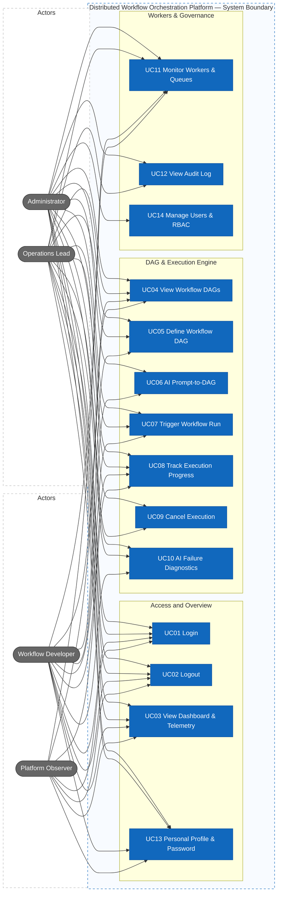
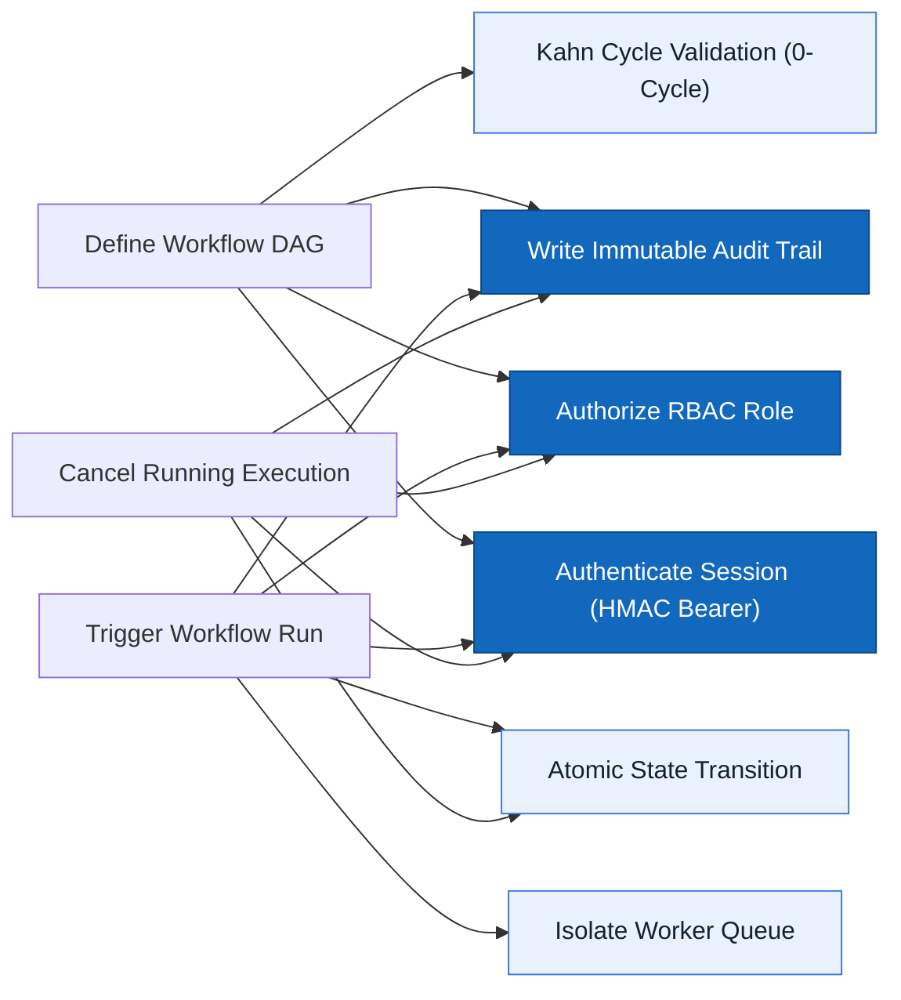

# Actors, roles, and use cases — Distributed Workflow Orchestration Platform

> Design status: TARGET V1  
> Implementation status: FULL BASELINE IMPLEMENTED (FastAPI + React Console)

Product name: **Distributed Workflow Orchestration Platform (DWOP) / NexusDAG**.

---

## 1. Actors / roles

| Role | Display name in UI | Primary Responsibility |
|---|---|---|
| `ADMIN` | Administrator | Full cluster governance, user RBAC management, audit log inspection, and configuration. |
| `OPERATOR` | Operations Lead | Day-to-day operations: triggers workflow executions, cancels runaway runs, monitors worker loads, and executes AI failure diagnostics. |
| `DEVELOPER` | Workflow Developer | Designs workflow DAG schemas, tests dependencies, uses AI Prompt-to-DAG generation, and triggers test executions. |
| `VIEWER` | Platform Observer | Read-only access: inspects cluster telemetry, active runs, worker nodes, and task queue distributions. |

---

## 2. Role × feature matrix

| Capability | Administrator | Operations Lead | Workflow Developer | Platform Observer |
|---|---|---|---|---|
| Cluster Dashboard & Telemetry | ✓ | ✓ | ✓ | ✓ |
| View Workflow DAGs | ✓ | ✓ | ✓ | ✓ |
| Define & Edit Workflow DAG | ✓ | ✓ | ✓ | |
| AI Prompt-to-DAG Generator | ✓ | | ✓ | |
| Trigger Workflow Run | ✓ | ✓ | ✓ | |
| View Real-time Step Timeline | ✓ | ✓ | ✓ | ✓ |
| Cancel Running Execution | ✓ | ✓ | | |
| AI Failure Diagnostics (Self-Healing) | ✓ | ✓ | ✓ | |
| Monitor Workers & Task Queues | ✓ | ✓ | ✓ | ✓ |
| Activity Audit Log | ✓ | ✓ | | |
| Manage Users & Roles (RBAC) | ✓ | | | |
| Personal Profile & Credentials | ✓ | ✓ | ✓ | ✓ |

Menus and action buttons are **not displayed** in the UI when the user lacks permission. Unauthorized URL navigation resolves to the `#/403` (Forbidden) screen.

---

## 3. Use Case Diagram

Every use case is modeled as a discrete system capability within the DWOP boundary. Administrator and Operations Lead are placed on the left; Workflow Developer and Platform Observer are placed on the right.

---

## 4. Shared Rules and Constraints

- **Cycle Invariant:** Any DAG submission with circular dependencies (`A -> B -> A`) is deterministically rejected by Kahn's algorithm before persistence.
- **Queue Isolation:** Worker task dispatching is strictly partition-based (`default`, `compute`, `data-io`, `payment`, `ai-agent`).
- **All roles:** Can log in, log out, view dashboard, view workflows, and update their personal profile.

---

## 5. Detailed Use Cases

### UC01 Login
- **Actor:** All roles (`ADMIN`, `OPERATOR`, `DEVELOPER`, `VIEWER`).
- **Preconditions:** Active user account exists with PBKDF2 password hash.
- **Main flow:** Enter email and password (or select one-click demo pill) → Submit login → Backend verifies PBKDF2 hash → Generates stateless HMAC-SHA256 Bearer access token → Writes `LOGIN` audit record → Redirects to Dashboard.
- **Alternative:** Invalid credentials → Returns `401 Unauthorized` with Problem Details (`AUTH_INVALID_CREDENTIALS`).
- **Permission:** Public (`/api/v1/auth/login`).
- **Result:** Authenticated session established with Bearer token stored in client storage.

### UC02 Logout
- **Actor:** All roles.
- **Preconditions:** Client is authenticated.
- **Main flow:** Click user menu → Select "Đăng xuất" → Discard Bearer token and session from client storage → Redirects to Login screen.
- **Permission:** Authenticated.
- **Result:** Protected routes are no longer accessible without re-authenticating.

### UC03 View Dashboard & Telemetry
- **Actor:** All roles.
- **Preconditions:** User is logged in.
- **Main flow:** View 4 live KPI cards (Total Workflows, Running Instances, Active Workers, Success Rate) → Inspect cluster telemetry (Kahn scheduling, queue isolation, SPOF-free indicators) → Inspect recent executions table with live step progress bars.
- **Permission:** `dashboard`.
- **Result:** Live visibility into cluster operational health.

### UC04 View Workflow DAGs
- **Actor:** All roles.
- **Main flow:** Navigate to `/workflows` → Review list of defined DAGs → Inspect visual mini-pipeline nodes with directed arrows and assigned queue tags → Open detail modal to review dependencies (`dependsOn`), timeout limits, and raw JSON schema.
- **Permission:** `workflowRead`.
- **Result:** Read-only observers see full DAG topology without mutation controls.

### UC05 Define Workflow DAG
- **Actor:** Administrator, Operations Lead, Workflow Developer.
- **Main flow:** Open "Tạo Workflow Mới" modal → Enter workflow name, description, and DAG steps JSON → Submit → Backend validates DAG via Kahn's algorithm → Checks for circular dependencies and missing parents → Persists in `workflow_definitions` → Records audit entry → Refreshes workflow list.
- **Alternative:** Cycle detected → Throws `400 Bad Request` (`CYCLE_DETECTED`).
- **Permission:** `workflowWrite`.
- **Result:** New acyclic workflow is immediately available for triggering.

### UC06 AI Prompt-to-DAG Generator
- **Actor:** Administrator, Workflow Developer.
- **Main flow:** Open "AI Sinh Workflow (Prompt-to-DAG)" → Enter business description in natural language (or select sample prompts: ETL, Payment Saga, AI Training) → AI Engine interprets requirements → Synthesizes complete DAG JSON with optimal queue routing and retry policies → Pre-fills creation modal with AI reasoning note → User confirms and saves DAG.
- **Permission:** `workflowWrite`.
- **Result:** Multi-step DAG generated in seconds without manual JSON editing.

### UC07 Trigger Workflow Run
- **Actor:** Administrator, Operations Lead, Workflow Developer.
- **Main flow:** Select workflow → Click "Trigger Run" → Enter Input Payload (JSON) → Backend instantiates `workflow_instances` with status `RUNNING` → DAG Engine computes ready root steps (`dependsOn == []`) → Dispatches corresponding tasks to `task_executions` with status `SCHEDULED` → Emits audit log.
- **Permission:** `executionTrigger`.
- **Result:** New execution instance starts immediately and step progress updates in real time.

### UC08 Track Execution Progress
- **Actor:** All roles.
- **Main flow:** Navigate to `/executions` → Filter by status (`ALL`, `RUNNING`, `COMPLETED`, `FAILED`, `CANCELLED`) → Click execution row to open detailed slide-over → Inspect vertical timeline showing step status, assigned worker ID, queue name, and retry count.
- **Permission:** `executionRead`.
- **Result:** Granular observability into distributed step lifecycle.

### UC09 Cancel Execution
- **Actor:** Administrator, Operations Lead.
- **Main flow:** Inspect running execution (`status == RUNNING`) → Click "Hủy lượt chạy" → Confirm action → Backend transitions instance and all non-completed tasks to `CANCELLED` → Workers cancel ongoing tasks → Writes `CANCEL` audit record.
- **Permission:** `executionCancel`.
- **Result:** Run terminates immediately, freeing up worker concurrency slots.

### UC10 AI Failure Diagnostics (Self-Healing)
- **Actor:** Administrator, Operations Lead, Workflow Developer.
- **Main flow:** Open failed execution (`status == FAILED`) → Click "AI Chẩn Đoán Lỗi" → AI Assistant inspects failure log, step context, and worker metrics → Returns diagnosis panel showing Root Cause, Severity (`HIGH`/`MEDIUM`), and actionable Self-Healing instructions.
- **Permission:** `executionRead`.
- **Result:** Immediate incident triage without manual log spelunking.

### UC11 Monitor Workers & Task Queues
- **Actor:** All roles.
- **Main flow:** Navigate to `/workers` → Inspect cluster-wide slot utilization percentage → Review individual worker cards (Online status, heartbeat timestamp, current load / max concurrency) → Inspect breakdown table for the 5 isolated task queues.
- **Permission:** `workerRead`.
- **Result:** Cluster hardware and task queue saturation visibility.

### UC12 View Audit Log
- **Actor:** Administrator, Operations Lead.
- **Main flow:** Navigate to `/audit` → Filter immutable audit trail by action (`LOGIN`, `INSERT`, `UPDATE`, `DELETE`), actor, or date range → Inspect actor identity, affected module, timestamp, and action description.
- **Permission:** `auditRead`.
- **Result:** Full security and operational traceability for compliance.

### UC13 Personal Profile & Password
- **Actor:** All roles.
- **Main flow:** Navigate to `/profile` → Review account details, role pill, and unique user ID → Switch to "Bảo mật" tab to update password → Switch to "Vai trò & Quyền hạn" tab to inspect current RBAC permissions matrix.
- **Permission:** Authenticated.
- **Result:** Self-service profile management with immutable role restrictions.

### UC14 Manage Users & RBAC
- **Actor:** Administrator.
- **Main flow:** Navigate to `/users` → Filter by status (`All`, `Active`, `Disabled`) → Inspect user directory, assigned roles (`ADMIN`, `OPERATOR`, `DEVELOPER`, `VIEWER`), and last activity.
- **Permission:** `userManagement`.
- **Result:** Centralized control over cluster identity and access.
