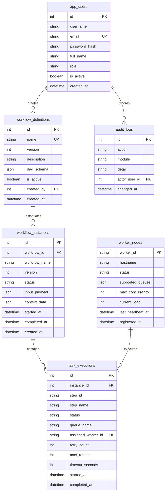

# Data Model — Distributed Workflow Orchestration Platform

Tài liệu mô hình dữ liệu quan hệ của hệ thống điều phối tiến trình phân tán.

---

## 1. Sơ Đồ Thực Thể Quan Hệ (Entity Relationship Diagram)

