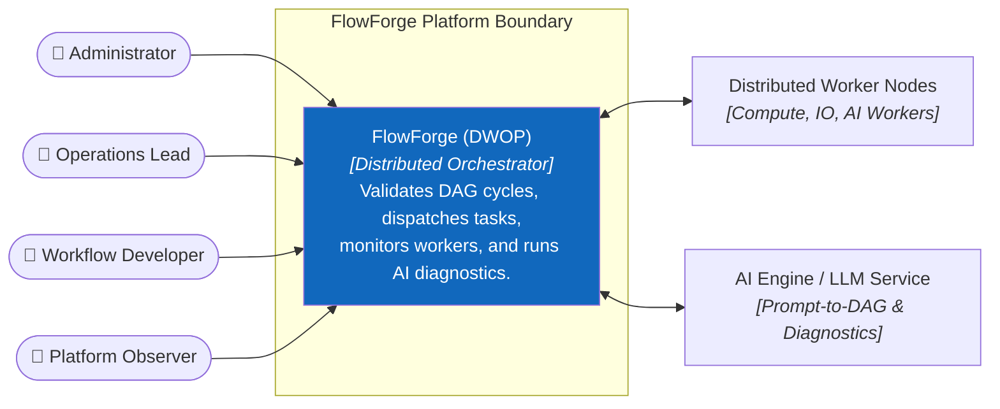

# 3. Context and Scope

The context defines the external actors, worker nodes, external services, and platform boundaries of FlowForge (DWOP).

## System Boundary

### Inside FlowForge
- DAG schema validation and topological sort (Kahn's algorithm).
- Workflow instance execution state machine.
- 5 isolated task dispatch queues.
- Worker heartbeat monitoring and slot allocation.
- AI Prompt-to-DAG and failure diagnostics.
- Role-based authorization and immutable audit trail.

### Outside FlowForge
- Physical or virtual server infrastructure running worker processes.
- External OpenAI / LLM provider API.
- Customer third-party services invoked by tasks (Slack, external REST webhooks).
