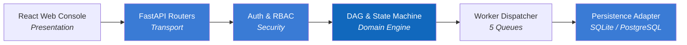

# 4. Solution Strategy

## 4.1 Strategy in One Sentence

Separate presentation, orchestrator brain, and execution nodes into `React Web Console → FastAPI Orchestrator Core → Isolated Worker Queues & Database (SQLite/PostgreSQL)`, enforcing deterministic Kahn cycle prevention and AI-assisted self-healing.

## 4.2 Goal-to-Solution Mapping

| Goal | Strategy |
|---|---|
| Responsive Developer UI | React 18 + Vite SPA with interactive DAG visualizers and Dark/Light mode |
| Zero Deadlock / Cycle Risk | Kahn's Topological Sorting algorithm executes synchronously before saving any DAG |
| Execution State Integrity | Finite State Machine (`PENDING` -> `RUNNING` -> `COMPLETED`/`FAILED`/`CANCELLED`) |
| No Worker Queue Starvation | 5 isolated queues (`default`, `compute`, `data-io`, `payment`, `ai-agent`) |
| Rapid Incident Recovery | AI Copilot analyzes task error logs to output Root Cause and Self-Healing actions |
| Security & Compliance | Stateless HMAC-SHA256 Bearer tokens, RBAC gating, and append-only audit trail |

## 4.3 Dependency Direction

