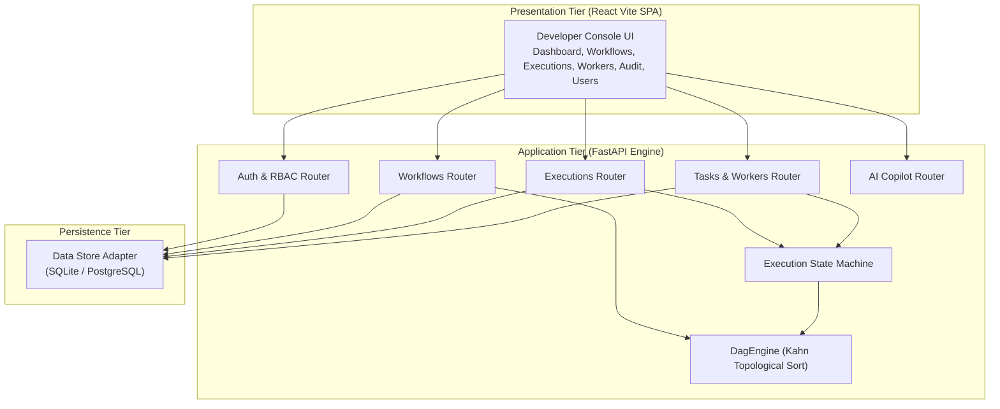

# 5. Building Block View

## 5.1 Level 1 — Whitebox Overall System

## 5.2 Level 2 — Application Core Modules

1. **`DagEngine` (`app/domain/dag_engine.py`):**
   - Validates DAG step IDs and non-empty steps.
   - Enforces zero-cycle topological ordering using Kahn's Algorithm.
   - Computes ready steps whose prerequisites have completed.

2. **`ExecutionService` (`app/services/execution_service.py`):**
   - Manages workflow instances and step lifecycle transitions.
   - Dispatches ready steps to queues.
   - Handles emergency run cancellations.

3. **`WorkerService` (`app/services/worker_service.py`):**
   - Manages worker node registrations and heartbeats.
   - Provides task polling for workers across 5 isolated queues.

4. **`AiOrchestratorService` (`app/services/ai_service.py`):**
   - Translates natural language descriptions into valid DAG JSON schemas.
   - Diagnoses execution failure logs and suggests actionable self-healing fixes.
