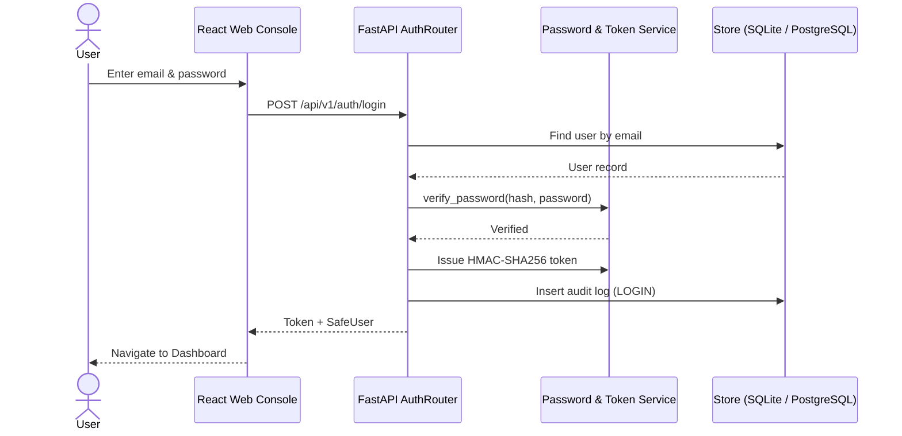
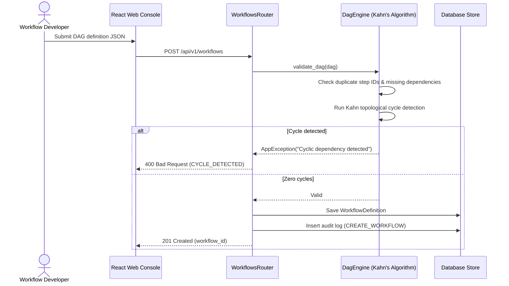
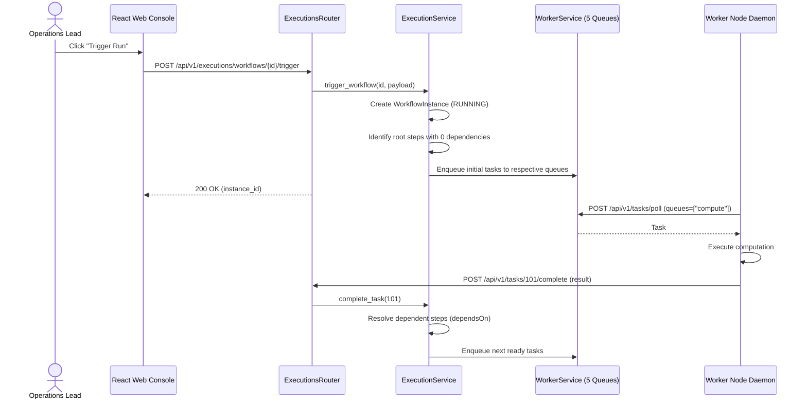
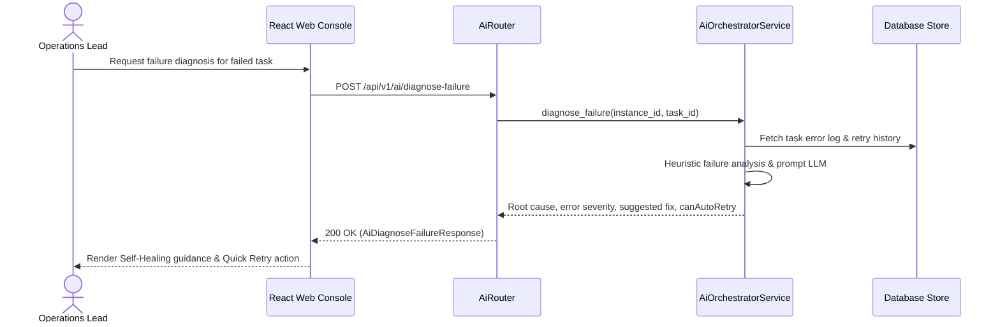

# 6. Runtime View

The runtime view describes dynamic execution scenarios across FlowForge components.

## 6.1 Authentication

## 6.2 Workflow DAG Validation & Creation

## 6.3 Trigger Execution & Worker Polling Loop

## 6.4 AI Failure Diagnostics & Self-Healing

