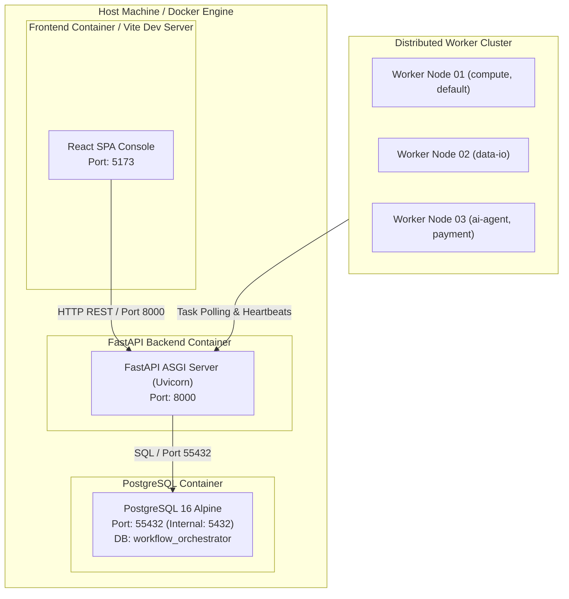

# 7. Deployment View

FlowForge supports two deployment configurations: Local Development (Embedded) and Containerized Multi-Service (Docker Compose).

## 7.1 Docker Compose Services

- **`postgres`:** PostgreSQL 16 image, exposed on `127.0.0.1:55432`.
- **`backend`:** Python 3.10+ FastAPI uvicorn daemon.
- **`frontend`:** React 18 / Vite SPA console.
