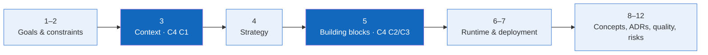

# FlowForge (DWOP) — arc42 Architecture Documentation

> **Status:** Baseline · **Audience:** Developers, reviewers, system architects, and maintainers

This documentation uses the international arc42 template to describe the goals, constraints, building blocks, runtime scenarios, and architectural decisions of **FlowForge (Distributed Workflow Orchestration Platform - DWOP)**.

## Contents

| Section | Content |
|---|---|
| 1 | [Introduction and Goals](01-introduction-and-goals.md) |
| 2 | [Architecture Constraints](02-architecture-constraints.md) |
| 3 | [Context and Scope](03-context-and-scope.md) |
| 4 | [Solution Strategy](04-solution-strategy.md) |
| 5 | [Building Block View](05-building-block-view.md) |
| 6 | [Runtime View](06-runtime-view.md) |
| 7 | [Deployment View](07-deployment-view.md) |
| 8 | [Cross-cutting Concepts](08-crosscutting-concepts.md) |
| 9 | [Architecture Decisions](09-architecture-decisions.md) |
| 10 | [Quality Requirements](10-quality-requirements.md) |
| 11 | [Risks and Technical Debt](11-risks-and-technical-debt.md) |
| 12 | [Glossary](12-glossary.md) |

## Baseline Architecture

- **Presentation Layer:** React 18 + Vite SPA, Tailwind CSS / modern CSS, Dark & Light Mode console.
- **Application Core:** Python 3.10+ FastAPI ASGI, async execution engine, Kahn's algorithm DAG cycle detection, and LLM Copilot.
- **Data Persistence:** Dual-mode SQLite (local embedded) & PostgreSQL 16 (containerized Docker Compose).
- **Worker Infrastructure:** 5 isolated task queues (`default`, `compute`, `data-io`, `payment`, `ai-agent`) with periodic heartbeats.
- **Security:** PBKDF2-HMAC-SHA256 password hashing, stateless HMAC-SHA256 Bearer Token, RBAC, and append-only audit logging.

Related: [C4 Model Views](../c4/README.md) · [API Documentation](../../api/README.md) · [Invest Requirements](../../08-invest-requirements.md).
