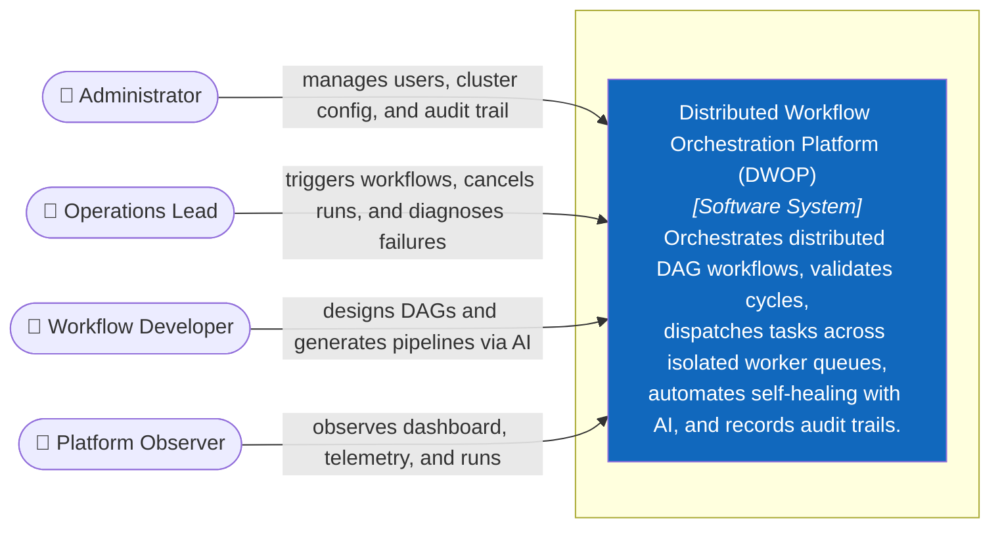

# C1 — System Context

> **Purpose:** Illustrate who interacts with the Distributed Workflow Orchestration Platform (DWOP) and the platform's core boundaries, independent of internal implementation technologies.

## System Boundary

Distributed Workflow Orchestration Platform (FlowForge DWOP) serves as the **Master Orchestration Brain** for engineering and DevOps teams.

It is strictly responsible for:
1. **DAG Graph Validation:** Topological sorting and cycle detection using Kahn's Algorithm.
2. **Execution Lifecycle Management:** Managing workflow instances across `PENDING`, `SCHEDULED`, `RUNNING`, `COMPLETED`, `FAILED`, and `CANCELLED` states.
3. **Queue-Isolated Task Dispatching:** Asynchronous assignment across 5 isolated task queues (`default`, `compute`, `data-io`, `payment`, `ai-agent`).
4. **Worker Fleet Monitoring:** Periodic worker heartbeats, concurrency slot allocation, and orphaned task reclamation.
5. **AI Copilot & Self-Healing:** Natural-language Prompt-to-DAG generation and automated failure root cause diagnostics.
6. **Governance & Security:** RBAC role enforcement (Admin, Operator, Developer, Viewer) and append-only immutable audit logging.

## Users and Primary Permissions

| Person / Role | UI Display Name | Primary Responsibilities |
|---|---|---|
| **Administrator** | Administrator | Full cluster governance, user RBAC management, cluster settings, and audit logs. |
| **Operations Lead** | Operations Lead | Day-to-day operations: triggers workflow executions, cancels runaway runs, monitors worker loads, and executes AI failure diagnostics. |
| **Workflow Developer** | Workflow Developer | Designs workflow DAG schemas, validates step dependencies, uses AI Prompt-to-DAG generation, and triggers test runs. |
| **Platform Observer** | Platform Observer | Read-only access: inspects cluster telemetry, active runs, worker nodes, and task queue distribution. |

**Next:** zoom into the Software System → [C2 — Container](02-container.md).

**Sources of truth:** `docs/01-scope.md`, `docs/02-features.md`, `docs/03-use-cases.md`.
