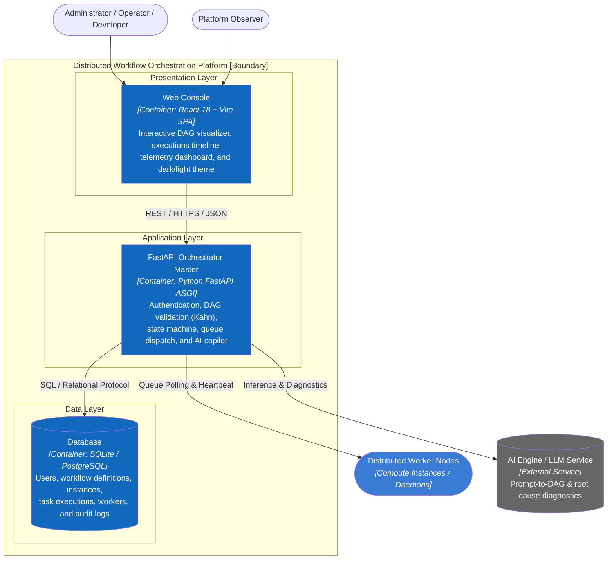

# C2 — Container

> **Purpose:** Zoom into the Distributed Workflow Orchestration Platform boundary and describe runtime and storage containers, protocols, and data flow.

## Container Responsibilities

| Container | Technology | Responsibility | Status |
|---|---|---|---|
| **Web Console** | React 18, Vite, Tailwind CSS, Lucide Icons | Responsive operator console, DAG visual pipeline view, real-time step progress, execution controls, and theme switching. | Fully Implemented (`src/frontend/`) |
| **FastAPI Orchestrator Master** | Python 3.12, FastAPI, Pydantic, Uvicorn | Trust boundary: Bearer token auth, Kahn cycle validation, execution state machine, 5-lane queue routing, and AI Copilot integration. | Fully Implemented (`src/backend/app/`) |
| **Database** | SQLite / PostgreSQL | ACID persistence for DAG definitions, execution instances, task states, registered workers, and immutable audit logs. | Fully Implemented (`src/database/`) |
| **Distributed Workers** | Python Worker Daemons / External Services | Polls task queues, executes assigned tasks, reports heartbeats, and submits step outputs/failures. | Fully Implemented (`src/backend/app/demo_run.py`) |
| **AI LLM Service** | Local / Cloud LLM API | Generates JSON DAG definitions from natural-language prompts and analyzes failed task logs for root-cause diagnosis. | Fully Implemented (`app/services/ai_service.py`) |

## Core Architecture Rules

1. **Topological Invariant:** No workflow can be saved or triggered unless Kahn's Algorithm confirms it is acyclic ($0$ cycles).
2. **Queue Isolation:** Heavy compute or AI tasks (`compute`, `ai-agent`) never share queues with rapid I/O or transactional steps (`data-io`, `payment`, `default`).
3. **Stateless API:** Master backend authenticates requests via HMAC-SHA256 Bearer tokens, keeping session state in client storage and relational DB.
4. **Append-Only Auditing:** Security and orchestration events (login, create DAG, trigger run, cancel execution) are written to an append-only audit trail.

**Previous:** [C1 — System Context](01-system-context.md) · **Next:** zoom into the FastAPI Master → [C3 — Component](03-component.md).
