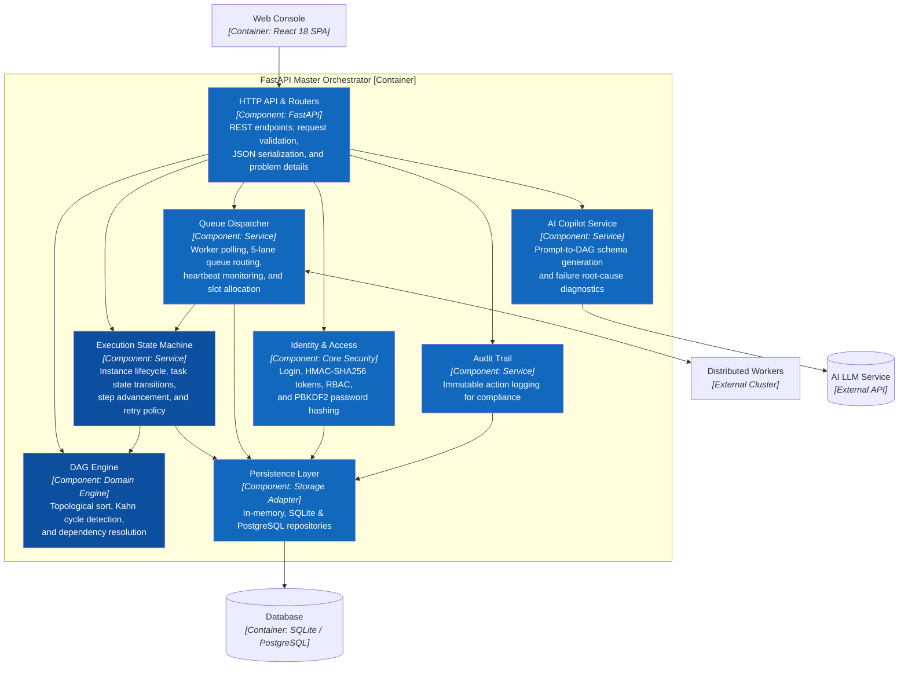

# C3 — Component — FastAPI Master Orchestrator

> **Purpose:** Zoom into the FastAPI Master Orchestrator container and detail its internal modular components, service boundaries, and dependency flows.

## Component Catalog

| Component | Source Path | Primary Ownership | Excluded / Does Not Own |
|---|---|---|---|
| **HTTP API & Routers** | `app/api/` | HTTP status codes, OpenAPI schema, DTO validation, REST routing. | Database transactions or workflow logic. |
| **Identity & Access** | `app/core/security.py` | Bearer token creation/verification, password hashing, RBAC role guard. | UI display decisions. |
| **DAG Engine** | `app/domain/dag_engine.py` | Graph validation, in-degree calculation, Kahn's topological sort, cycle detection. | Runtime state or database persistence. |
| **Execution State Machine** | `app/services/execution_service.py` | Instance transitions (`RUNNING`, `COMPLETED`, `FAILED`, `CANCELLED`), task advancement, retries. | Low-level HTTP requests. |
| **Queue Dispatcher** | `app/services/worker_service.py` | 5 priority queues (`default`, `compute`, `data-io`, `payment`, `ai-agent`), worker heartbeat, task polling. | Direct DAG graph validation. |
| **AI Copilot Service** | `app/services/ai_service.py` | LLM prompt engineering, Prompt-to-DAG JSON schema synthesis, log root cause analysis. | Executing tasks. |
| **Audit Trail** | `app/domain/models.py` | Recording security events, triggers, cancellations, and DAG modifications. | Modifying workflow states. |
| **Persistence Layer** | `app/persistence/` | Relational SQLite/PostgreSQL schemas, transactions, unified store abstraction. | Business decision making. |

## Inter-Component Dependency Flow

1. **DAG Creation Flow:** `HTTP API → Identity (Verify RBAC) → DAG Engine (validate_dag via Kahn) → Persistence → DB`.
2. **Trigger Execution Flow:** `HTTP API → Execution Service → DAG Engine (get_root_steps) → Persistence (create instance & tasks) → Queue Dispatcher`.
3. **Task Completion Flow:** `Worker Node → Queue Dispatcher → Execution Service (advance_instance) → DAG Engine (get_next_steps) → Persistence`.
4. **AI Self-Healing Flow:** `HTTP API → AI Service (diagnose_failure with task error log) → Return Root Cause & Fix Recommendation`.

**Previous:** [C2 — Container](02-container.md) · **Next:** zoom into the Core Engines → [C4 — Code](04-code.md).
