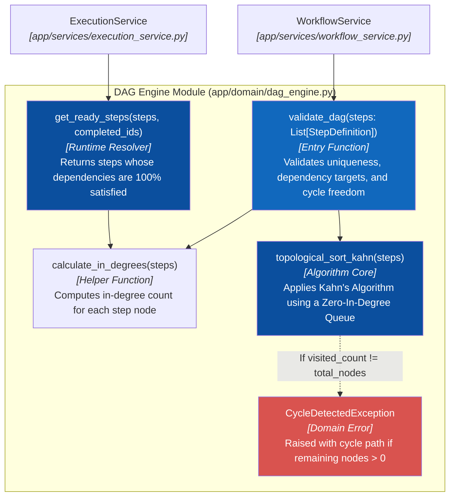
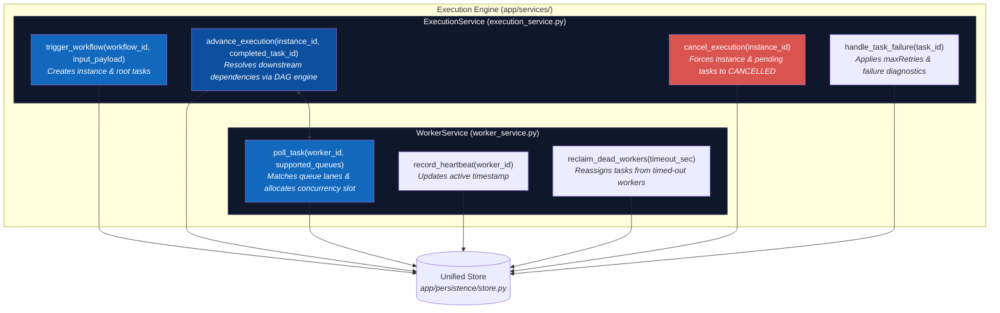

# C4 Level 4 — Code — Two Core Engines

> **Purpose:** Zoom into the implementation details of the two most critical engines in the Distributed Workflow Orchestration Platform: Kahn's DAG Engine and the Execution State Machine & Worker Dispatcher.

---

## L4.1 Kahn's Algorithm DAG Engine

The DAG engine (`app/domain/dag_engine.py`) guarantees that no cyclic dependency or invalid flow can enter the orchestration system.

### Kahn's Algorithm Invariant
Given a workflow with $N$ step nodes:
1. Compute in-degree (number of prerequisites) for all $N$ steps.
2. Initialize queue $Q$ with all nodes having $\text{in-degree} = 0$.
3. While $Q$ is not empty: dequeue node $u$, increment `visited_count`, and for each node $v$ depending on $u$, decrement $\text{in-degree}(v)$. If $\text{in-degree}(v) == 0$, push $v$ to $Q$.
4. **Invariant:** If $\text{visited\_count} < N$, a closed cycle exists; the engine rejects the workflow immediately.

---

## L4.2 Execution State Machine & Worker Dispatcher

The execution engine manages asynchronous task dispatching across 5 isolated queues and orchestrates state transitions.

### State Transition Lifecycle

$$\text{PENDING} \longrightarrow \text{SCHEDULED} \longrightarrow \text{RUNNING} \longrightarrow \begin{cases} \text{COMPLETED} & \text{(all steps succeeded)} \\ \text{FAILED} & (\text{retries exhausted} \rightarrow \text{AI Diagnostics}) \\ \text{CANCELLED} & (\text{operator manual stop}) \end{cases}$$

**Previous:** [C3 — Component](03-component.md) · **Up:** [C4 Architecture Overview](README.md).
