# C4 Model — Distributed Workflow Orchestration Platform (DWOP)

> **Status:** Architecture Baseline · **Audience:** Developers, Architects, SREs, and Platform Maintainers

The architecture documentation proceeds from the outside in using the C4 model. Every node specifies a **name**, **type** (`Person`, `Software System`, `Container`, `Component`), technology stack where relevant, and an exact operational description.

```mermaid
flowchart LR
    C1["C1 · System Context<br/><small>Who uses DWOP and why?</small>"]
    C2["C2 · Container<br/><small>What runtime units make up the platform?</small>"]
    C3["C3 · Component<br/><small>How is the FastAPI Master Orchestrator decomposed?</small>"]
    C4["C4 · Code<br/><small>How are the DAG Engine and Execution Dispatcher built?</small>"]
    C1 -->|"zoom into DWOP"| C2
    C2 -->|"zoom into FastAPI Orchestrator"| C3
    C3 -->|"zoom into DAG & Execution Engine"| C4
    style C1 fill:#1168bd,color:#fff,stroke:#0b4884
    style C2 fill:#1168bd,color:#fff,stroke:#0b4884
    style C3 fill:#1168bd,color:#fff,stroke:#0b4884
    style C4 fill:#1168bd,color:#fff,stroke:#0b4884
```

| Level | Document | Scope |
|---|---|---|
| C1 | [System Context](01-system-context.md) | 4 RBAC roles and the DWOP system boundary |
| C2 | [Container](02-container.md) | React Web Console, FastAPI Master, Worker Nodes, AI Copilot, SQLite/PostgreSQL |
| C3 | [Component](03-component.md) | Internal components inside the FastAPI Master Orchestrator |
| C4 | [Code — Two Core Engines](04-code.md) | Python classes/functions for Kahn's DAG Engine and Execution State Machine |

## Implementation Status

| Unit | Actual Status | Technology |
|---|---|---|
| **Web Console** | Fully implemented | React 18, Vite, Tailwind CSS, Lucide Icons |
| **Master Orchestrator** | Fully implemented | Python 3.12, FastAPI, Pydantic v2, ASGI |
| **DAG Engine** | Fully implemented | Pure Python Topological Sort & Kahn's Cycle Detection |
| **Execution State Machine** | Fully implemented | Async state transitions, retries, timeout, cancellation |
| **Distributed Worker Dispatcher** | Fully implemented | 5-queue routing (`default`, `compute`, `data-io`, `payment`, `ai-agent`) & Heartbeat |
| **AI Copilot** | Fully implemented | Prompt-to-DAG generation & Root-Cause Failure Diagnostics |
| **Persistence & Database** | Fully implemented | In-Memory Store, SQLite, and PostgreSQL relational schemas |

## Color Conventions

- **Dark blue (`#1168bd`)**: Primary system / container / component being described.
- **Deep Navy (`#0b4f9e`)**: Core domain engine (DAG engine, state machine).
- **Gray (`#666666`)**: External actor or external LLM service outside the primary cluster.
- **Dashed boundary**: Software System or Container boundary.

See also: [Use Cases](../../03-use-cases.md) · [Feature Specifications](../../02-features.md) · [Scope V1](../../01-scope.md).
