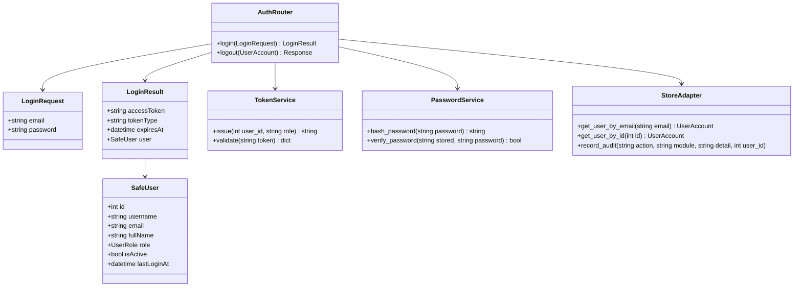
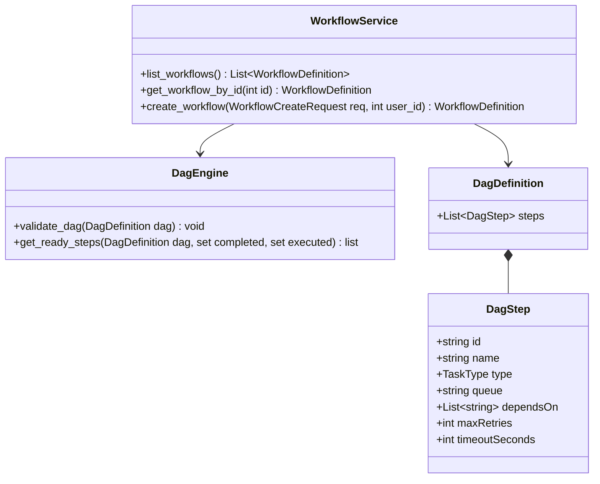
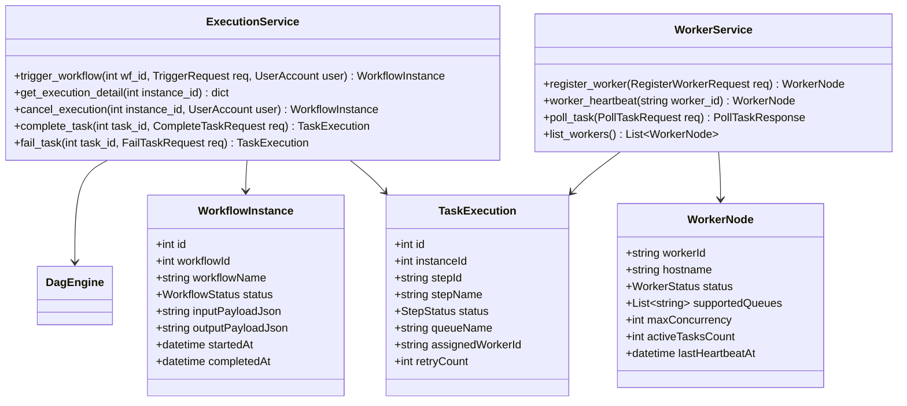
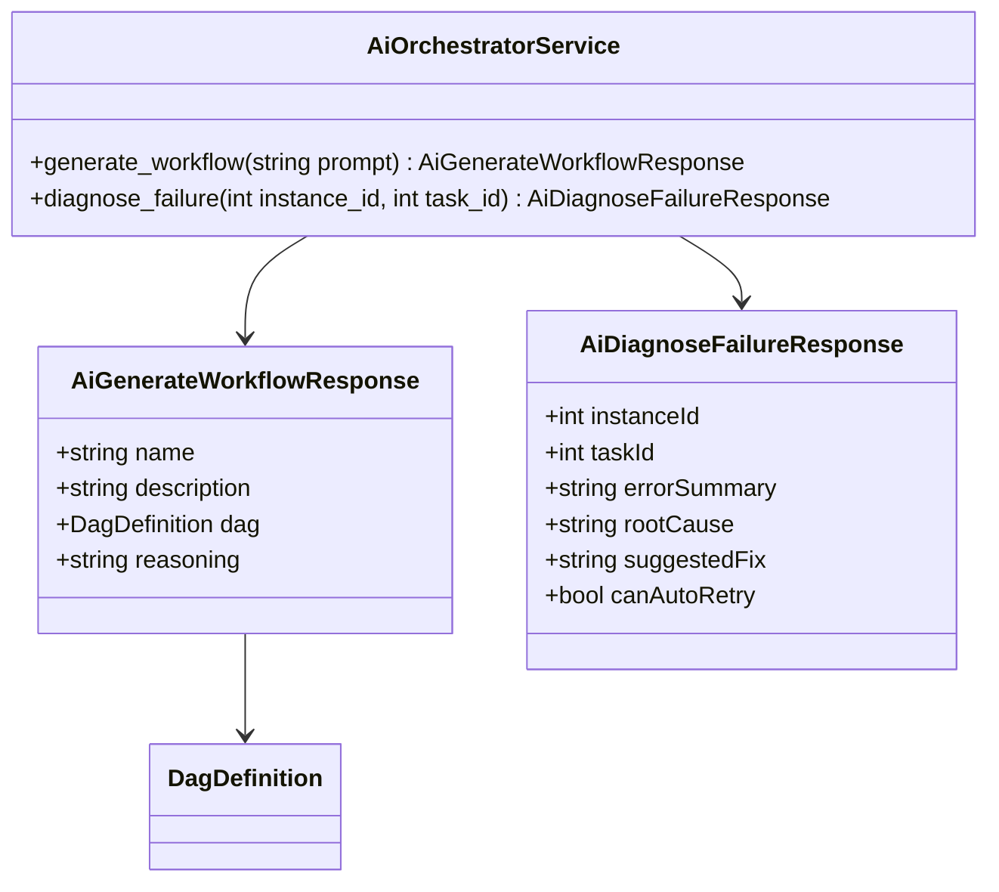

# Class Diagrams — FlowForge (DWOP)

The class diagrams follow the implementation in `src/backend/app/` covering Domain Models, Services, and FastAPI Routers.

## 1. Authentication & Identity

## 2. Workflow & DAG Engine

## 3. Execution Lifecycle & Distributed Workers

## 4. AI Copilot & Failure Self-Healing

