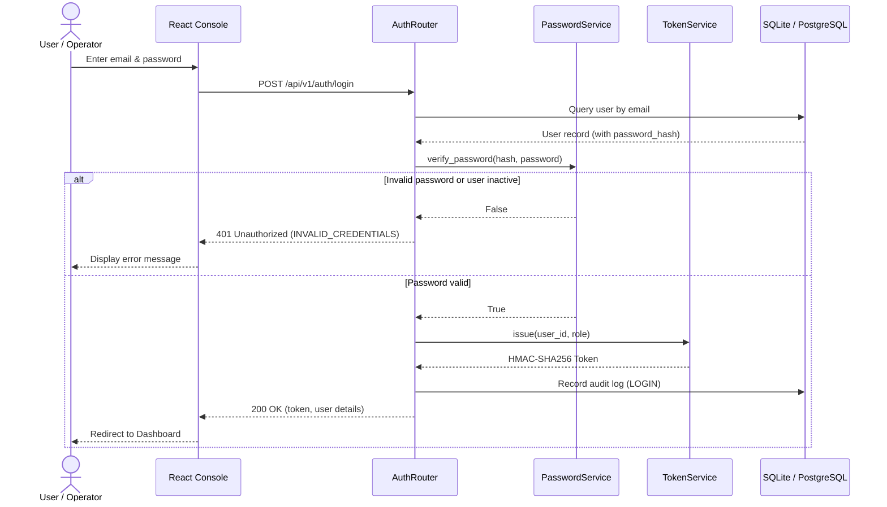
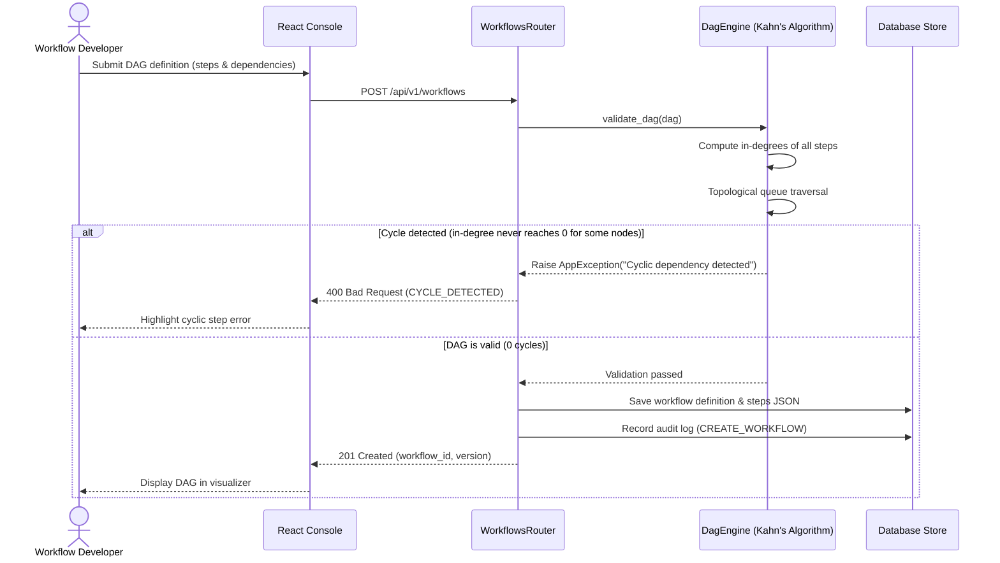
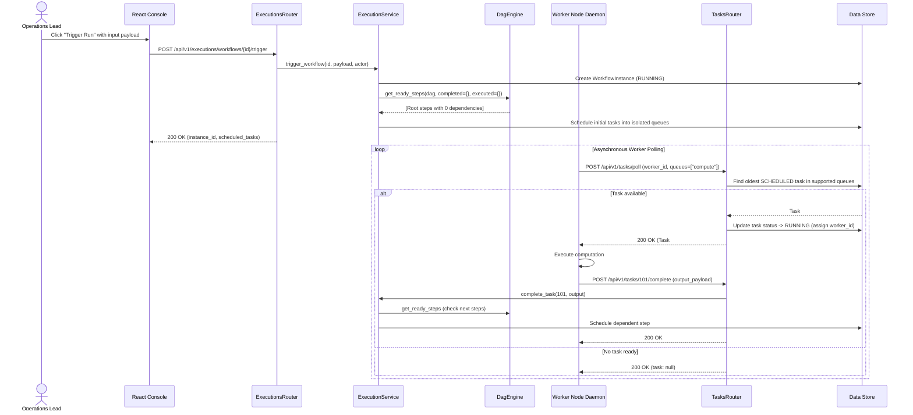
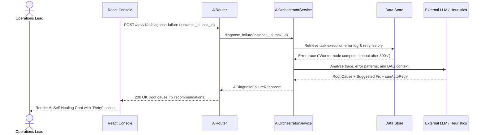

# Sequence Diagrams — FlowForge (DWOP)

The sequence diagrams document the key execution paths in the Distributed Workflow Orchestration Platform.

## 1. Authentication — `POST /api/v1/auth/login`

## 2. Workflow Creation with Kahn Cycle Detection — `POST /api/v1/workflows`

## 3. Execution Triggering & Worker Task Polling

## 4. AI Failure Diagnostics & Self-Healing

