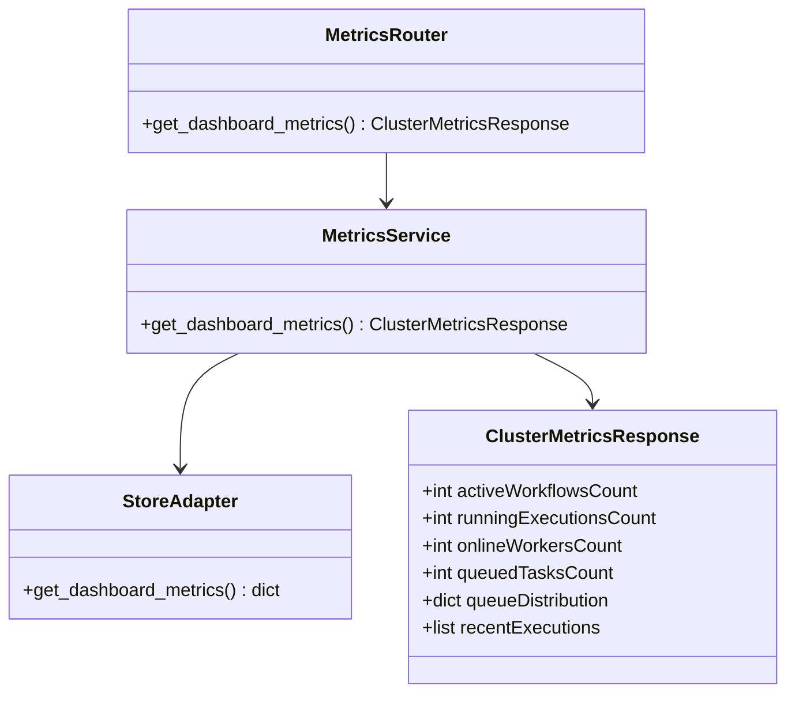
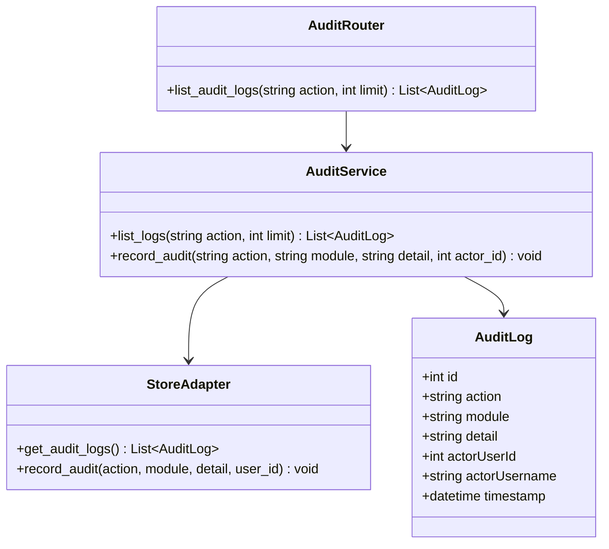
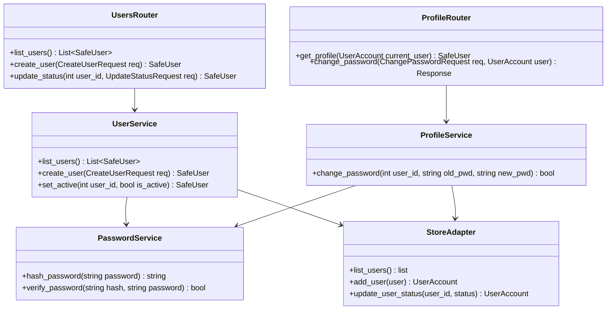

# Class Diagrams — Remaining FlowForge (DWOP) Modules

> **Design status:** TARGET V1  
> **Implementation status:** IMPLEMENTED AND VERIFIED (Python FastAPI & Pydantic Domain)

These diagrams describe the remaining subsystem models: Telemetry Metrics, Audit Logging, and User / Profile Management.

## 1. Cluster Metrics & Telemetry

## 2. Audit Trail & Compliance

## 3. User & Profile Management

